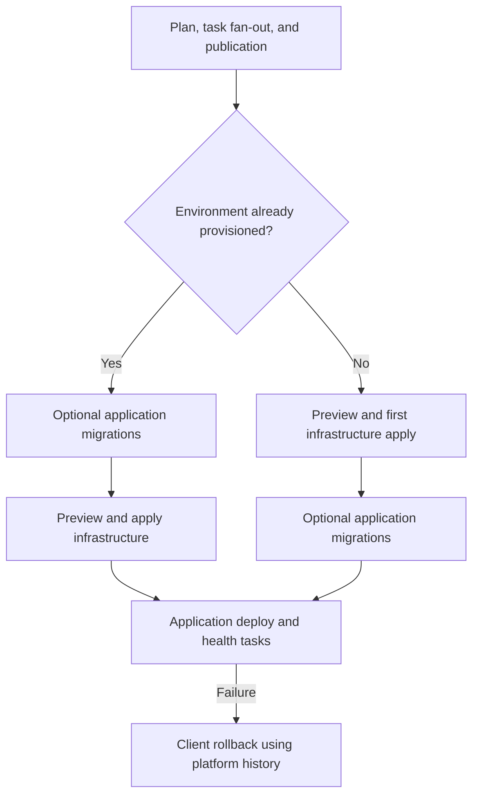
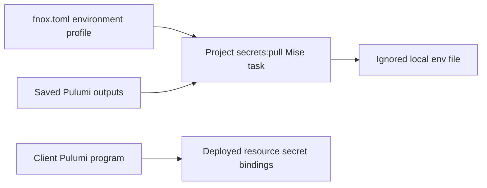

# Architecture

## Overview

Premise is a Git-native platform engineering toolkit. It uses Git repositories, Mise, monorepo conventions, task contracts, templates, and CI workflows to make development and delivery consistent across projects.

Premise includes project generation today, but the whole product is not permanently create-only. Generation currently creates new projects without overwriting destinations; template migration and other lifecycle capabilities are planned as separate workflows.

## Requirements

- Manage development environments, including tool versions, environment values, and installation through `pm install` and Mise.
- Provide a lightweight, package-manager-forward monorepo model that does not replace the package manager's dependency and workspace responsibilities.
- Provide a task runner through `pm run`, layered over Mise tasks and monorepo conventions.
- Derive automatic CI from task contracts so projects expose stable lifecycle names instead of provider-specific task glue.
- Scaffold projects and generate them from local or remote templates.
- Support future template migration for existing projects without changing the create-only generation workflow.
- Run client-owned Pulumi programs against a remote backend, with one stack per environment and branch-specific preview stacks.
- Run optional application migrations and deployment tasks, using native platform rollback after application failures.
- Create local env files through fnox and project Mise tasks; bind deployed secrets through client infrastructure code.

## Design

The architecture combines workspace tools, project tasks, infrastructure, and application delivery:

| Component | Responsibility |
| --- | --- |
| **Development Environment (`pm install` / Mise)** | Mise owns declared tools, versions, environment resolution, and installation. Premise provides the workspace entry point and conventions around that environment. |
| **Monorepo and Task Runner (`pm run` layered over Mise)** | Premise discovers the workspace and its projects, applies `apps/` and `libs/` conventions, and routes root or project task requests to Mise. Package managers remain responsible for package dependencies and workspace behavior. |
| **Scaffolding and Template Management** | `template_registry` declares selectable templates and explicit repository-root workspace files. A repository can also contain generated projects. Generation applies answers and creates one nested project. |
| **Automatic CI (GitHub Action and task contracts)** | The GitHub Action installs tools and plans check/publication jobs. Hosted workflows invoke explicit infra, migration, and deployment commands after those gates. The local `pm ci flow` command uses the same module APIs. |

## Environment delivery

The client owns the program under `infra/`, including the language, resource declarations, imports, and deployed secret bindings. `Pulumi.yaml` selects the runtime. Root `mise.toml` pins Pulumi and runtime tools. `premise.yaml` selects the program directory, named remote backends, environment values, and applications with deployment contracts.



Infrastructure and migration failures stop the flow. Clients apply database infrastructure changes before migrations and keep migrations backward compatible. An application rollback restores the previous platform revision; it does not reverse migrations or infrastructure updates. Pulumi's backend owns resource state and state locking. CI concurrency serializes deployments for an environment. Premise stores no separate recovery ledger.

Feature pushes create or update preview stacks through `on-commit`. Main-branch pushes deploy `dev` through `on-merge`, after checks and publication. `on-deploy` is manual. Preview cleanup remains in `on-merge`, on merged pull requests or branch deletion. Repositories without infrastructure do not create deployment environments.



Local env files combine JSON secret documents with queried infrastructure values. Deployment credentials use OAuth, workload identity, or protected CI credentials. Provider configuration belongs in Mise or the environment, keeping shared workflows cloud agnostic. See [secret management](secret-management.md) and [provider authentication](providers/README.md).

## Overall Module Dependency Tree

```text
[cmd]
  |
  +--> [Configuration] --> [Project]
  |
  +--> [Registry] --> [Template Source]
  |
  +--> [Questionnaire]
  |
  +--> [Template] -----------------+
  |                                |
  +--> [Generate] --> [Merge] -----+
  |                                |
  +--> [Development Environment] --+
  |                                |
  +--> [Task] ---------------------+--> [Mise]
  |                                |
  +--> [CI] -----------------------+
  |      +--> [Infra] --> [Pulumi extension + Providers]
  |      +--> [Migrations] --------+
  |      `--> [Deploy / Rollback] -+
  |                                |
  +--> [Secrets] --> [Fnox extension + Project tasks]
  |                                |
  +--> [Version] --> [Git + svu]   |
  |                                |
  +--> [Release] ------------------+
  |      `--> [PackageManagerBackend] <--- [core/backends]
  |
  `--> [Updater] --> [HTTP Installer]
```

## Command Dependency Graphs

Each map distinguishes modules called directly by the command from modules used internally by those entry-point modules. Indentation represents dependency ownership, not execution order.

### `pm init`

```text
[pm init]
  |
  `-- direct --> [Configuration]
                  initialize the selected workspace kind, manifest, and layout
```

### `pm install`

```text
[pm install]
  |
  +-- direct --> [Configuration]
  |               locate the workspace and inspect project Mise files
  |
  +-- direct --> [Development Environment]
  |               install tools declared by root and project Mise configuration
  |
  `-- direct --> [Task]
                  invoke the optional workspace-level install contract
```

### `pm run`

```text
[pm run <task|project:task>]
  |
  `-- direct --> [Task]
                  parse and route the task selector
                    |
                    +-- uses --> [Configuration]
                    |             resolve a project name to its recorded path
                    |
                    `-- uses --> [Mise boundary]
                                  execute the task in the resolved directory
```

### `pm generate`

```text
[pm generate [selector]]
  |
  +-- direct --> [Configuration]
  |               verify that the current directory is in a workspace
  |
  +-- direct --> [Registry]
  |               classify and resolve the selector argument
  |
  +-- direct --> [Questionnaire]
  |               provide interactive selector and answer collection
  |
  `-- direct --> [Generate]
                  own the complete generation operation
                    |
                    +-- uses --> [Configuration]
                    |             load and save the client manifest
                    |
                    +-- uses --> [Registry]
                    |             load the selected template declaration
                    |
                    +-- uses --> [Questionnaire]
                    |             collect answers declared by the template
                    |
                    +-- uses --> [Project]
                    |             validate and persist project provenance
                    |
                    +-- uses --> [Merge]
                    |             resolve registry-root file contributions
                    |
                    +-- uses --> [Template]
                    |             resolve, render, and validate template files
                    |
                    +-- uses --> [Task]
                    |             resolve the contract task set
                    |
                    `-- uses --> [Mise boundary]
                                  merge tool configuration and validate candidates
```

### `pm template init`

```text
[pm template init]
  |
  +-- direct --> [Configuration]
  |               locate the template-registry workspace
  |
  +-- direct --> [Questionnaire]
  |               select app or library kind when omitted
  |
  `-- direct --> [Template]
                  create the template declaration, files, and Mise contract
```

### `pm template detect`

```text
[pm template detect]
  |
  +-- direct --> [Configuration]
  |               locate the current Premise workspace
  |
  `-- direct --> [Registry]
                  classify its lifecycle from workspace configuration
```

### `pm template ls`

```text
[pm template ls]
  |
  +-- direct --> [Configuration]
  |               locate the current Premise workspace
  |
  `-- direct --> [Registry]
                  load and list declared template entries
```

### `pm template test`

```text
[pm template test]
  |
  +-- direct --> [Configuration]
  |               load the registry manifest
  |
  `-- direct --> [Template]
                  resolve and test every declared template
                    |
                    +-- uses --> [Task]
                    |             resolve each kind's contract task set
                    |
                    `-- uses --> [Mise boundary]
                                  run contracts; inspect clean without erasing caches
```

### `pm ci flow`

```text
[pm ci flow <on-commit|on-merge|on-deploy>]
  |
  +-- direct --> [Configuration]
  |               locate the workspace root
  |
  +-- direct --> [Package Manager]
  |               register built-in manager implementations
  |
  `-- direct --> [CI]
                  select and gate lifecycle-specific behavior
                    |
                    +-- uses --> [Configuration / Registry]
                    |             detect workspace kind and declared templates
                    |
                    +-- uses --> [Mise boundary]
                    |             inspect and execute lifecycle tasks directly
                    |
                    +-- uses --> [Release]
                    |             perform the permitted publication phase
                    |
                    `-- uses --> [Infra / Migrations / Deploy]
                                  run the selected environment flow or preview cleanup
```

### `pm version`

```text
[pm version <current|next|bump|rc>]
  |
  +-- direct --> [Configuration]
  |               locate the Premise repository root
  |
  `-- direct --> [Version]
                  derive stable, bumped, or release-candidate versions from Git
```

### `pm release`

```text
[pm release]
  flags: --dry-run | --build
  |
  +-- direct --> [Configuration]
  |               locate the workspace and load release settings
  |
  +-- direct --> [Package Manager]
  |               register built-in manager implementations
  |
  `-- direct --> [Release]
                  own planning or the selected release operation
                    |
                    +-- uses --> [Version]
                    |             calculate and validate version and tag
                    |
                    +-- uses --> [Package Manager]
                    |             read metadata, preflight, prepare, and publish
                    |
                    `-- uses --> [Mise boundary]
                                  run RC tasks and resolve GoReleaser tooling
```

The public release command has one default workflow:

```text
pm release              : prepare and publish the complete release
pm release --dry-run    : plan without mutation
pm release --build      : build release artifacts without publishing
```

Credential-separated preparation and publication remain available through the core API for CI orchestration.

### `pm update`

```text
[pm update [version]]
  |
  `-- direct --> [CLI-local updater]
                  validate the requested SemVer, download the bounded installer,
                  and replace the executable in its current installation directory
```

`pm update` intentionally has no dependency on a core domain module.

Dependencies point inward toward shared contracts. Core does not import built-in backend implementations. The CLI registers implementations and then calls core workflows. `workspace.package_managers` selects backends explicitly; native files provide package metadata but never select a manager. Managers that claim the same ecosystem, such as Bun and pnpm for npm packages, conflict.

Premise implements environment setup, monorepo task routing, scaffolding, template-root merging, contract-driven CI, client-owned infrastructure, optional migrations, application rollback, and local env-file generation. Template migration remains future work.

## Implementation

Mise owns tools, environments, and task execution. Premise manages monorepo conventions on top of Mise and uses task contracts for CI.

Generation relies on the expected monorepo structure when it selects a destination and records provenance. Template registry and generated-project capabilities may coexist; `workspace.kind` selects default CI behavior rather than enforcing exclusive repository contents.

Infrastructure setup and saved-state queries live in `core/infra.go`. Application deployment and native rollback live in `core/deploy.go`; optional migration groups live in `core/migrations.go`. Provider interfaces and authentication implementations live in `core/providers`. External-tool wrappers for Pulumi, fnox, and Git live in `core/extensions`.

`pm infra setup --pulumi-lang go` adds a client program and the missing manual deployment workflow to an existing workspace. `pm infra query` reads saved state for project tasks. `pm secrets pull` selects project tasks that use native fnox profiles and write their own env files. The [infrastructure module](modules/infrastructure.md) documents configuration and Go/TypeScript examples.

The [Module Documentation](modules/README.md) index links one design document per major module, including API usage and implementation details. The detailed create-only generation and template-root merge design is documented in [Generation Architecture](generation.md). The focused merge policy remains in [ADR 0003](../adr/0003-template-root-merging.md).

## References

- [User Guide](user-guide.md)
- [Module Documentation](modules/README.md)
- [Configuration Module](modules/configuration.md)
- [Development Environment Module](modules/development-environment.md)
- [Project Module](modules/project.md)
- [Registry Module](modules/registry.md)
- [Questionnaire Module](modules/questionnaire.md)
- [Template Module](modules/template.md)
- [Generate Module](modules/generate.md)
- [Merge Module](modules/merge.md)
- [Task Module](modules/task.md)
- [Package Manager Module](modules/package-manager.md)
- [Version Module](modules/version.md)
- [Release Module](modules/release.md)
- [CI Module](modules/ci.md)
- [Generation Architecture](generation.md)
- [Infrastructure](infrastructure.md)
- [ADR 0003: Focused template-root merge policies](../adr/0003-template-root-merging.md)
- [Mise configuration](https://mise.jdx.dev/configuration.html)
- [GitHub Actions](https://docs.github.com/en/actions)
