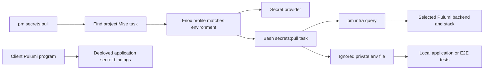
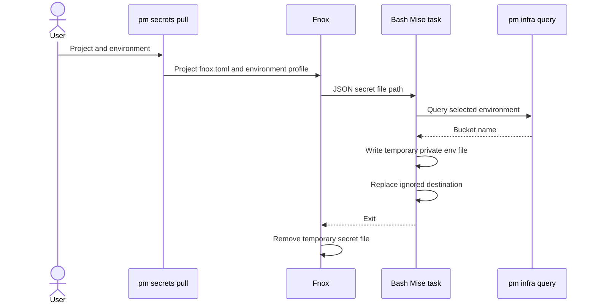

# Local env files architecture

## Overview

Fnox stores secret references and environment profiles. A project Mise task writes the env file used by local runs or E2E tests. Client Pulumi code configures secrets for deployed applications.

Premise has one public secrets command: `pm secrets pull`. It does not introduce another secret schema, a process-execution command, or CI secret synchronization.

## Requirement

### Functional

- Discover optional project `secrets:pull` tasks.
- Select the fnox profile using the requested environment.
- Give the task environment and preview branch context.
- Let Bash combine fnox values and saved infra queries into env files.
- Keep deployed application secrets in the client Pulumi program.

### Non-Functional

- Keep provider references in fnox.toml and out of premise.yaml.
- Keep secret values out of Git and command output.
- Use standard tool behavior and client tasks.
- Let the client task own filenames, permissions, and atomic replacement.

## Design

### Components and Responsibilities



The secrets module selects projects and environment context. The fnox extension supplies provider values to the task. The task writes its files. Pulumi owns deployed secret bindings.

### Data and Control Flow



The task receives `PM_ENV` and `PM_BRANCH`. It can select more than one local destination. The example task preserves the existing destination on failure. Premise suppresses output from the pull task.

### Interfaces and Contracts

`PullProjectSecrets` selects a named project or all projects with `secrets:pull`. Each selected project must contain `fnox.toml`. Fnox owns secret references and the profiles named dev, stage, prod, and preview.

No `ProjectSecrets` schema exists in premise.yaml. There is no declarative env mapping. The Bash task is the mapping and file-writing contract.

## Implementation

### Owned modules

```text
cmd/secrets.go                 # Public pull command
core/secrets.go                # Task discovery and environment context
core/infra.go                  # Saved-state queries and native infra operations
core/deploy.go                 # Application tasks and client rollback
core/extensions/fnoxx.go       # Fnox process boundary
core/extensions/pulumix.go     # Pulumi process boundary
core/extensions/gitx.go        # Preview branch lookup
core/providers/provider.go     # CI and infra provider interfaces
```

### Validation

The CLI test uses real fnox and a Bash task to generate private ignored env files. The live GCS test also queries the real environment bucket. It deploys a static page, runs a fake migration, and uses GCS object versions for application rollback.

Infrastructure and migration failures stop the pipeline. Application deploy or health failures call client rollback tasks. Native backend locking and CI environment concurrency replace custom recovery storage.

## References

- [Secret management](../secret-management.md)
- [Infrastructure module](../modules/infrastructure.md)
- [Pulumi rollback guidance](https://www.pulumi.com/docs/support/faq/infrastructure/)
