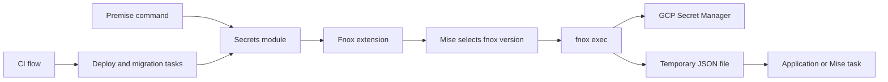
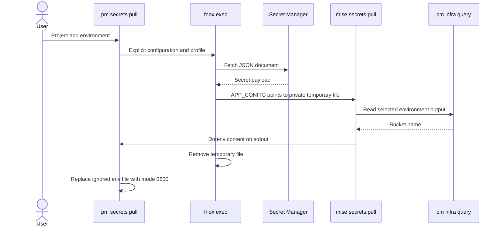

# Application secrets architecture

## Overview

Premise selects an application and environment. Fnox retrieves a JSON secret document and owns its temporary file. The application reads that file. Local commands and CI use the same path.

Env-file generation belongs to a project Mise task. That task can combine secret fields with saved Pulumi outputs. Premise captures its dotenv output and writes a private ignored file.

## Requirement

### Functional

- Select one explicit fnox profile for each environment.
- Run application commands through fnox exec locally and in CI.
- Generate an optional env file from JSON secrets and infrastructure queries.
- Preserve the existing env file when generation fails.
- Run deployment and migration tasks with their application's secret profile.

### Non-Functional

- Store secret references in Git and secret values in the provider.
- Give fnox ownership of resolution and temporary-file cleanup.
- Keep cloud authentication in provider adapters.
- Keep tool process boundaries in core/extensions.
- Avoid CI copies of application secrets and a second scalar-key schema.

## Design

### Components and Responsibilities



- The secrets module selects the project, profile, and output destination.
- The fnox extension launches the executable through Mise.
- Fnox retrieves the document and manages its temporary file.
- The client task parses JSON and owns application-specific values.
- Provider adapters authenticate infrastructure tools and CI identities.

### Data and Control Flow



If fnox or the task fails, Premise keeps the previous env file. It does not print captured content or task diagnostics. `pm secrets exec` streams child output, so applications must avoid printing secrets.

CI authenticates first. Deploy and migration tasks with a secrets declaration then use the same fnox execution path. Recovery runs without automatic secret resolution.

### Interfaces and Contracts

`ProjectSecrets` contains `config`, `profiles`, and the optional env `file`. Fnox configuration declares JSON documents with `as_file = true`. Premise does not expose scalar key selection or CI secret synchronization.

The `secrets:pull` task receives `PM_ENV`, `PM_BRANCH`, and inherited backend selection. It emits dotenv content on stdout. The caller chooses an ignored `.env` destination. The client owns JSON field names and dotenv encoding.

`InfraProvider` owns cloud authentication. `CIProvider` owns runner outputs and identity exchange. Application secrets come from fnox, so CI adapters do not copy them between stores.

## Implementation

### Owned modules

```text
cmd/
  secrets.go                 # Flags and calls into the secrets module
core/
  secrets.go                 # Profiles, task execution, private env files
  infra.go                   # Setup, apply, saved-state queries, authentication
  deploy.go                  # Ordering, deployment, records, and recovery
  release.go                 # Typed release values from the CI environment
  extensions/
    fnoxx.go                 # fnox exec process boundary
    pulumix.go               # Pulumi process boundary through Mise
  providers/
    provider.go              # CIProvider and InfraProvider contracts
    github.go                # GitHub outputs and identity exchange
    gcp.go                   # GCP credentials and storage access
```

Existing tool wrappers remain in place until a separate migration. The local review notes contain the requested tracker draft for that work.

### Validation

The local CLI test executes real fnox across dev, stage, prod, and preview profiles. It tests private JSON files, successful cleanup, failed-child cleanup, and identical local/CI behavior. A second CLI test generates ignored env files and preserves an existing file after failure.

The opt-in live GCS flow combines a JSON secret with the bucket output in each environment. It also checks backend selection, migration execution, application upload, rollback, and merge cleanup. Run it separately from CI.

## References

- [Secret management](../secret-management.md)
- [Infrastructure module](../modules/infrastructure.md)
- [fnox exec](https://fnox.jdx.dev/cli/exec.html)
- [fnox GCP Secret Manager](https://fnox.jdx.dev/providers/gcp-sm.html)
