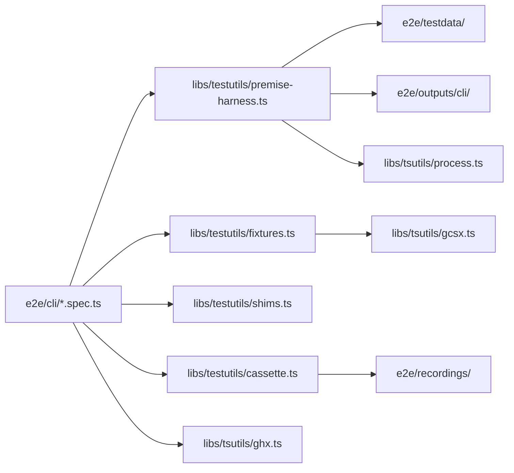
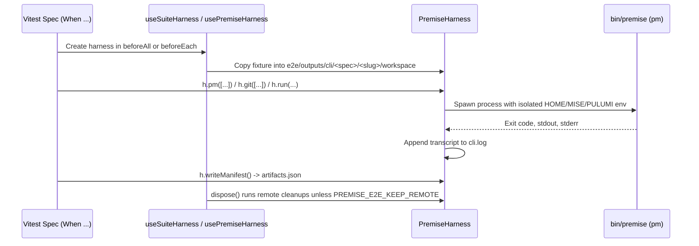

# E2E testing and testutils architecture

## Overview

Premise CLI end-to-end specs live in `e2e/cli/*.spec.ts` and run through Vitest against the compiled `pm` binary. Reusable test orchestration, fixture builders, executable command shims, and HTTP/Git cassette replay live in `libs/testutils/`, while general-purpose TypeScript utilities and CLI/SDK extensions live in `libs/tsutils/`.

Every test run copies real fixture workspaces from `e2e/testdata/` into `e2e/outputs/cli/<spec>/<test-slug>/workspace/`, logs every subprocess invocation to `cli.log`, and writes an inspectable `artifacts.json` manifest. Local outputs stay on disk after both passing and failing runs so humans and agents can inspect generated files and command output directly.

## Architecture

### Execution modes

`libs/testutils/mode.ts` resolves `PREMISE_E2E_MODE` into one of three modes:

- `replay` (default in CI): runs offline against real local fixtures, executable command shims, and recorded cassettes in `e2e/recordings/`. Live cloud tests skip automatically via `isLiveOrRecordMode()`.
- `live`: runs against real providers (dedicated GCP project `cloudvoyant-premise` and private GitHub fixture repo) without modifying recordings.
- `record`: runs live and refreshes redacted cassettes in `e2e/recordings/`.

### Suite and test lifecycle

Specs nest `Given ...`, `When ...`, and `It ...` blocks. Expensive CLI flows run once inside a `When ...` `beforeAll` hook backed by `useSuiteHarness`, and individual `it("It should ...")` cases assert independent outcomes against the captured state.

## `libs/testutils/` API

| Module | Exports | Responsibility |
| --- | --- | --- |
| `premise-harness.ts` | `PremiseHarness`, `REPO_ROOT`, `TESTDATA_ROOT`, `OUTPUTS_ROOT`, `RECORDINGS_ROOT`, `resolvePremiseBinary` | Owns one isolated workspace, logs commands to `cli.log`, writes `artifacts.json`, and runs registered remote cleanup callbacks on `dispose()`. |
| `fixtures.ts` | `usePremiseHarness`, `useSuiteHarness`, `copyScaffold`, `collectLocalFiles`, `setupGenericInfraWorkspace`, `configureLiveInfraWorkspace`, `createNativeRegistry`, `commitChange` | Vitest lifecycle hooks, fixture copying (excluding `.git`, `.pulumi`, `node_modules`, and stack files), local artifact hashing, and workspace builders. |
| `shims.ts` | `installCommandShims`, `installPmShim`, `installGcloudOidcReplayShim`, `installSourceReleaseShims` | Writes executable `0755` shell shims under `outputDir` for replay-mode external CLI boundaries (`gcloud`, `mise`, `goreleaser`, `pm`). |
| `cassette.ts` & `cassette-proxy.ts` | `Cassette`, `CassetteProxy` | Records and replays HTTP/Git traffic fail-closed with token redaction so replay runs make zero live network calls. |
| `config.ts` | `suiteConfig` | Shared Vitest configuration (tag registry, timeouts, sequential execution, output exclusions) consumed by `e2e/cli/vitest.config.ts`. |
| `mode.ts` | `e2eMode`, `isReplayMode`, `isLiveOrRecordMode`, `shouldKeepRemote` | Parses `PREMISE_E2E_MODE` and `PREMISE_E2E_KEEP_REMOTE`. |
| `cleanup.ts` | CLI entry (`mise run e2e:cleanup`) | Cleans up retained remote GitHub and Pulumi/GCS resources listed in an `artifacts.json` manifest. |

## `libs/tsutils/` boundary

General-purpose TypeScript helpers and external CLI/SDK extensions live in `libs/tsutils/` rather than `libs/testutils/`:

- `process.ts`: `execProcess` subprocess runner and `CommandResult` type.
- `fs.ts`: `sha256`, `slugify`, `hostCIPlatform`, `pathExists`.
- `gcsx.ts`: GCS and Pulumi backend helpers (`readGcsObject`, `readGcsBucketLabel`, `assertGcsBucketDeleted`, `assertSavedPulumiState`, `destroyPulumiStack`, `patchManifestInfra`, `resolveLiveGcpConfig`).
- `ghx.ts`: GitHub CLI helpers (`fixtureGithubRepo`, `assertPrivateFixtureRepo`, `deleteGithubBranch`, `deleteGithubReleaseAndTag`).

CLI and simple SDK wrapper modules use the `x` suffix (`ghx.ts`, `gcsx.ts`, matching Go's `pulumix.go` and `fnoxx.go`) to mark external tool boundaries.

## References

- [E2E guide](../../e2e/README.md)
- [Local env files architecture](./secrets.md)
