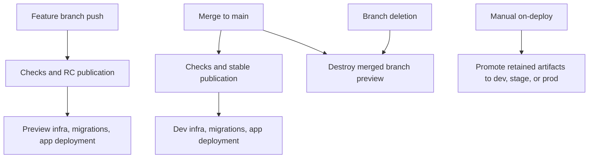

# Using automated CI

## Check a change

```sh
pm ci flow on-commit --release none
pm ci plan --flow on-commit --json
pm projects ls --flow on-commit --json
```

The flow runs project checks. The plan reports the required runners without running tasks. CI uses the same commands and can create separate project/platform jobs. See [CI](../modules/ci.md).

## Branches, merges, and manual deployment



`on-commit.yml` creates or updates previews on feature pushes. Pull requests run checks without publishing. `on-merge.yml` updates dev on main and destroys previews after merge or branch deletion. `on-deploy.yml` is manual-only. Libraries publish artifacts without creating GitHub deployment environments. Workspaces without infrastructure omit the manual deployment workflow; `pm infra setup` adds it later.

For a local environment flow, select an existing release:

```sh
export PM_RELEASE=COMMIT_SHA
pm ci flow on-commit --environment preview --branch feature/login --release none
pm ci flow on-deploy --environment stage
pm ci flow on-merge --environment preview --branch feature/login --release none
```

Each environment uses the [migration and deployment order](migrations.md). Hosted workflows run separate infrastructure, migration, and application steps. GitHub concurrency serializes an environment, and Pulumi locks its state during updates.

Deployment credentials use OAuth, workload identity, or protected CI secrets. Run `pm infra auth --ci` before infrastructure work. Mise installs the tools. See [secrets and configuration](secrets-and-config.md) and [provider authentication](../providers/README.md).

## Publish a release

Check the next version or build files without publication:

```sh
pm version current
pm version next
pm release --dry-run
pm release --build
```

Publish from a clean checkout after checks pass:

```sh
pm release
```

The generated main-branch workflow publishes stable releases. It creates or reuses the release tag, publishes downloadable files, then publishes eligible language packages.

For an RC that another repository must test, include the exact marker in a feature-branch commit:

```sh
git commit -m 'feat: add deployment support [publish-rc]'
git push
```

Wait for publication before selecting that RC in the dependent repository. Keep the action and CLI on the same version. Pull requests run checks without publishing. See [Release](../modules/release.md) for staged publication and credential setup.
