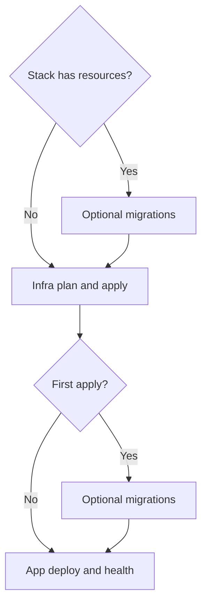

# Handling database migrations

## Deploy with migrations

Use `pm ci flow on-deploy` for the complete environment sequence:

```sh
export PM_RELEASE=COMMIT_SHA
pm ci flow on-deploy --environment stage
```

For an existing stack, the order is migrate, infra plan, infra apply, then application deploy and health checks. For a new stack, migration runs after the first apply. Applications without a migration task skip that step. Clients must apply database infrastructure changes separately before schema migrations and keep migrations backward compatible.

You can also run `pm migrate`, `pm infra plan`, `pm infra apply`, and `pm deploy` individually with `--env ENV`. `pm deploy` only deploys and checks application artifacts; it has no subcommands. Infra and migration failures stop the flow. Application deploy or health failures call the client rollback task, which uses platform revision history. See the [infrastructure guide](../modules/infrastructure.md) for configuration and rollback tasks.

## Optional application contract

Each application that needs migrations defines a native Mise task. The environment is a required task argument:

```toml
[tasks.migrate]
shell = "bash -c"
usage = 'arg "<environment>"'
run = '''
set -euo pipefail
scope=(--env "$usage_environment")
if [[ "$usage_environment" == preview ]]; then scope+=(--branch "$PM_BRANCH"); fi
export DATABASE_URL
DATABASE_URL="$(pm infra query "${scope[@]}" --output databaseUrl --show-secrets)"
bun run db:migrate
'''
```

Keep the task in the application's `mise.toml`. Use the application's normal migration tool and saved infrastructure outputs. Applications without this task are skipped. Independent migration groups can run concurrently; tasks within an explicit shared group run in order. Premise waits for all workers before returning a failure.



Clients apply database prerequisites separately before migrations and keep schema changes backward compatible. A migration or infrastructure failure stops the flow. Application deploy or health failure invokes client rollback tasks using platform history. Premise does not undo infrastructure updates or run down migrations. Correct the failure and retry; for an infrastructure revert, review and apply the reverted code against current state.

See the [infrastructure module](../modules/infrastructure.md) for migration groups, deployment configuration, and native rollback.
