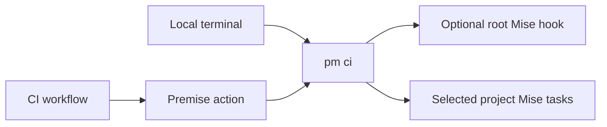
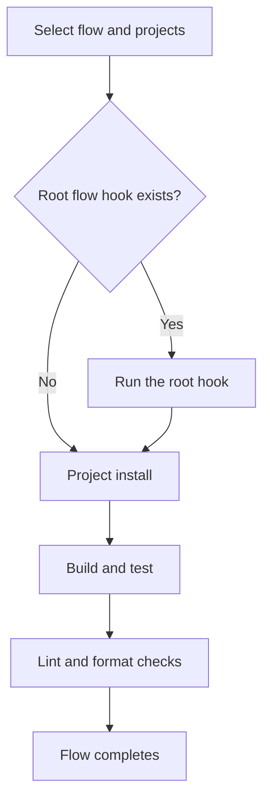
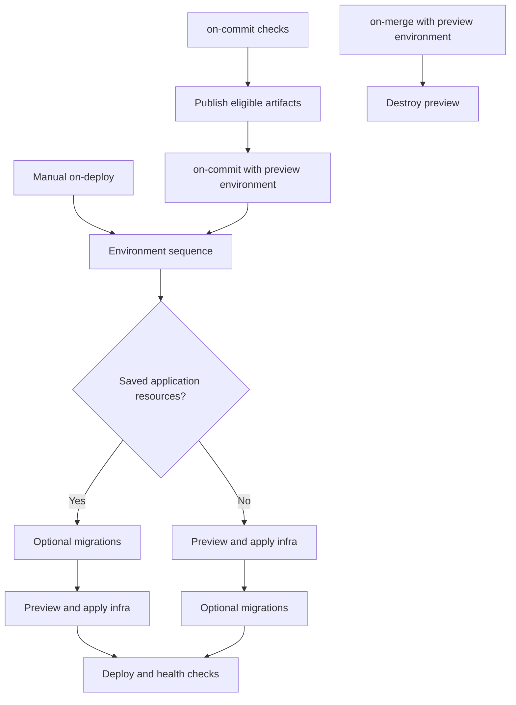
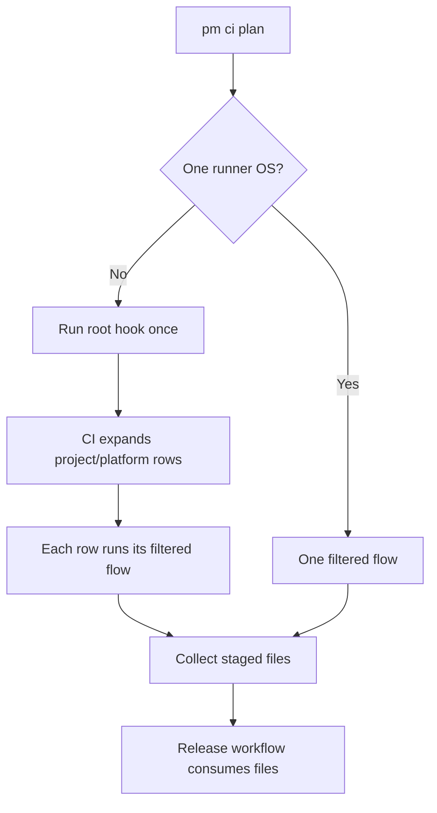

# CI Module

## Purpose

The CI module selects projects, plans runners, and runs project Mise tasks. The Premise action connects hosted jobs to the same CLI commands used locally.

## Design

### Responsibilities



Project tasks own installation, builds, tests, and quality checks. The CLI selects eligible projects and keeps their task order. A root flow hook runs once before the selected project checks.

### Usage

Run the same flow locally or on a hosted runner:

```sh
pm ci flow on-commit --release none
pm ci flow on-merge --project desktop --platform macos --release none
pm ci plan --flow on-commit --json
```



`on-commit` checks feature work. With `--environment preview`, it runs the preview environment sequence after checks and publication. `on-merge` checks trunk work. The hosted workflow deploys dev after checks and publication. With `--environment preview --branch NAME`, the local flow destroys that branch's preview. `on-deploy` runs a manually selected environment. Workflows use the has_infra plan output from premise.yaml to skip deployment jobs for workspaces without infra.



Hosted workflows call pm infra, pm migrate, and pm deploy in separate steps. The local CI flow calls the same module APIs. Clients apply database changes before an existing environment's migrations. See the [infrastructure module](infrastructure.md) for application rollback.

### Libraries installed from Git

A source-only library installs directly from Git and needs no compiled release files or package registry. For a Lua plugin generated with `premise-lib`, use an empty package-manager list:

```yaml
workspace:
  name: lua-plugin
  kind: monorepo
  schema-version: "0.2"
  package_managers: []
  providers: {ci: github}
  projects:
    - name: lua-plugin
      template: cloudvoyant/premise:premise-lib
      version: 0.1.0
      path: libs/lua-plugin
```

An omitted `package_managers` list also selects no backends. Do not add an unrelated backend or a `generic` entry. Unknown backend names remain errors.

The existing plan, flow, release, and packages action operations support this configuration. After validation, the release operation creates or reuses the version tag and publishes a GitHub release with a changelog. GitHub provides source downloads for the tag. No `publish`, `publish:rc`, or `release:build` Mise hook is required for this publication.

Stable releases keep the existing commit-based version rules. An RC release still requires a marked feature-branch push. The package operation reports a successful skip when no registry publisher is configured. `pm release --build` also reports a successful skip when there are no downloadable artifacts. GitHub publication still requires a token with permission to write repository contents.

### Hosted matrix

A matrix is a set of project and operating-system jobs. The planner includes single-platform projects when another project requires several runners.



```yaml
- uses: cloudvoyant/premise@v0
  id: plan
  with:
    command: plan
    flow: on-commit
    release: auto

- uses: cloudvoyant/premise@v0
  with:
    command: flow-matrix
    flow: on-commit
    project: ${{ matrix.project }}
    platform: ${{ matrix.platform }}
    skip-root: true
    release: none
```

### CI provider outputs

`pm ci plan --ci-output` formats the plan through the workspace's configured CI provider. The GitHub adapter writes step-output values, including the task matrix and migration matrix. `--json` returns the runner-independent plan. `--github-output` remains a compatibility alias for existing released workflows. CI-specific formatting lives under `core/providers`, not in command handlers or workflow Python scripts.

### API

| CLI command | Action command | Behavior |
| --- | --- | --- |
| `pm ci plan --flow FLOW` | `plan` | Return the runner schedule. |
| `pm ci flow FLOW` | `flow` | Run host-compatible tasks. |
| `pm ci flow FLOW --project NAME --platform OS` | `flow-matrix` | Run one declared project/platform pair. |

See [Project](project.md) for declarations and project listing, [Release](release.md) for publication, and [Infrastructure](infrastructure.md) for deployment commands.

## Implementation Details

`--project` and `--platform` filter work without changing task order. An unfiltered local flow excludes projects that require another operating system. A matrix row requires a matching host. `--root-only` runs the workspace hook. `--skip-root` prevents repeated root work in matrix rows.

`pm ci plan --github-output` writes `mode`, `runner`, `matrix`, `native`, and `release_version` to `GITHUB_OUTPUT`. `--json` reports the same schedule locally. GitHub owns job dependencies and file transfer. Native output uses job artifacts.

A `[publish-rc]` push can select RC publication after validation. Pull requests never publish. Platform jobs stage files but cannot publish independently. Release credentials belong to publication jobs.
