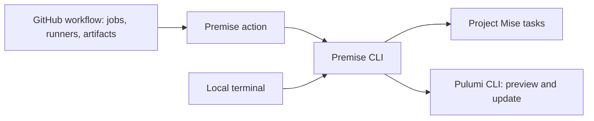
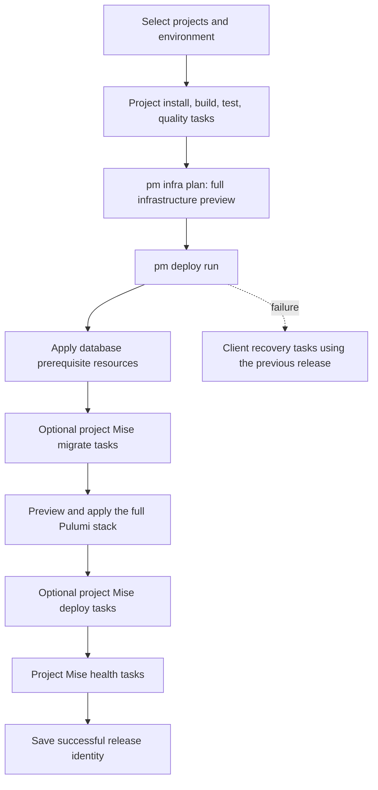
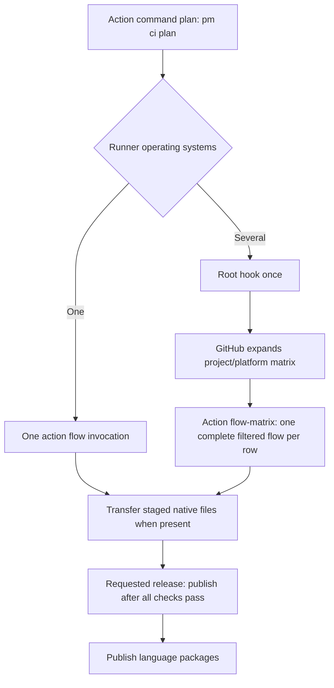

# CI Module

## Purpose

The CI module automates project tasks locally and in GitHub Actions. The Premise action installs tools and invokes the same CLI commands. Project-level Mise tasks own the build, tests, migrations, and any deployment work outside Pulumi.

## Design

### Responsibilities



The action connects GitHub's job inputs and outputs to the CLI. It does not define a second task lifecycle. A root Mise task can override a CI flow; otherwise the CLI runs the selected project tasks in order. Project identity and platform declarations are described in [Project](project.md). Artifact staging and publication are described in [Release](release.md).

### A local or hosted workflow



Commit and merge flows run validation and optional release staging. Deployment runs separately for an explicit environment. `pm ci flow on-release` is the older task-only lifecycle; `pm deploy run` runs the infrastructure lifecycle above. `pm infra apply` applies Pulumi resources directly and does not run migrations. See [Infrastructure](infrastructure.md) for deployment configuration, preview identities, and recovery.

### Scheduling a matrix

The CLI plans eligible project/platform pairs before GitHub creates jobs. Each matrix row runs the same filtered flow that can be run on a matching local host.



The schedule includes single-platform projects even when another project needs several platforms. GitHub owns job dependencies and file transfer. Native files are job artifacts. Release credentials belong to the publication jobs, not the validation matrix.

### Usage

```sh
pm ci flow on-commit --release none
pm ci flow on-merge --project desktop --platform macos --release none
pm ci plan --flow on-commit --json
pm deploy plan --env preview --branch feature/login
pm deploy run --env preview --branch feature/login --release COMMIT_SHA --artifact web=SOURCE_SHA
```

```yaml
- uses: cloudvoyant/premise@v0
  id: plan
  with:
    command: plan
    flow: on-commit
    release: auto

- uses: cloudvoyant/premise@v0
  with:
    command: flow-matrix
    flow: on-commit
    project: ${{ matrix.project }}
    platform: ${{ matrix.platform }}
    skip-root: true
    release: none
```

For infra and deploy commands, use the compatible release pin in the generated deployment workflow. The [infrastructure module](infrastructure.md) explains the required environment, backend, branch, and artifact inputs.

## Implementation Details

### Command API

| CLI command                                    | Action command  | Behavior                                                                |
| ---------------------------------------------- | --------------- | ----------------------------------------------------------------------- |
| `pm ci plan --flow FLOW`                       | `plan`          | Build the runner schedule without running project tasks.                |
| `pm ci flow FLOW`                              | `flow`          | Run host-compatible project tasks and optional native staging.          |
| `pm ci flow FLOW --project NAME --platform OS` | `flow-matrix`   | Run a declared project/platform row on a matching runner.               |
| `pm projects ls`                               | —               | Inspect eligible and excluded projects; see [Project](project.md).      |
| `pm release publish`                           | `release`       | Publish verified artifacts; see [Release](release.md).                  |
| `pm release packages`                          | `packages`      | Publish eligible language packages after the release.                   |
| `pm infra plan`                                | `infra-plan`    | Preview the selected environment stack.                                 |
| `pm infra destroy`                             | `infra-destroy` | Remove a preview or confirm a persistent-stack destroy.                 |
| `pm deploy plan`                               | `deploy-plan`   | Explain the deployment order and record destination.                    |
| `pm deploy run`                                | `deploy`        | Run provisioning, task hooks, full infrastructure update, and recovery. |

`--project` and `--platform` filter the selected work without changing its task order. An unfiltered local flow excludes projects that need other runner operating systems. A matrix row validates the declared target and its host before running tasks. `--root-only` runs just the workspace hook; `--skip-root` prevents a row from repeating it.

`pm ci plan --github-output` writes `mode`, `runner`, `matrix`, `native`, and `release_version` directly to `GITHUB_OUTPUT`. `--json` reports the same schedule for local inspection. A `[publish-rc]` push can request an RC publication; pull request checks never publish. Platform-scoped flows stage files but do not independently publish a repository release.

The deployment action restores and persists non-secret recovery records. Its workflow must serialize the complete deployment and disable cancellation. The backend, record storage, OAuth, and application-secret contracts are documented in [Infrastructure](infrastructure.md) and [Secret management](../secret-management.md).
