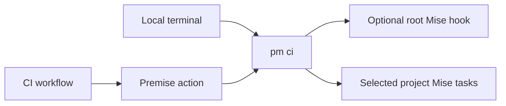
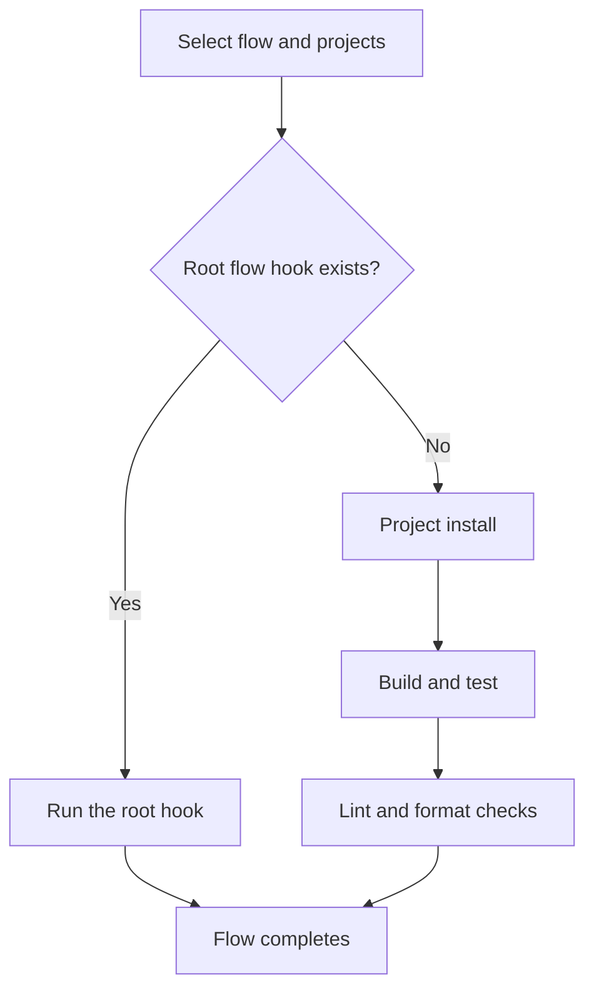
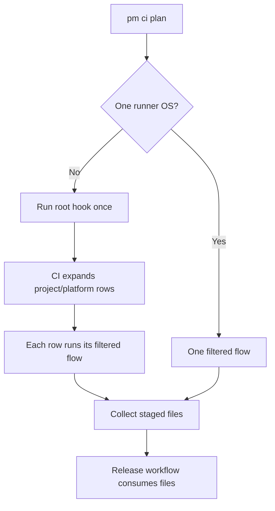

# CI Module

## Purpose

The CI module selects projects, plans runners, and runs project Mise tasks. The Premise action connects hosted jobs to the same CLI commands used locally.

## Design

### Responsibilities



Project tasks own installation, builds, tests, and quality checks. The CLI selects eligible projects and keeps their task order. A root flow hook can replace the fallback lifecycle.

### Usage

Run the same flow locally or on a hosted runner:

```sh
pm ci flow on-commit --release none
pm ci flow on-merge --project desktop --platform macos --release none
pm ci plan --flow on-commit --json
```



`on-commit` checks feature work. `on-merge` checks trunk work. `on-release` is the task-based application lifecycle. Use the [infrastructure module](infrastructure.md) for database provisioning, migrations, and deployment recovery.

### Hosted matrix

A matrix is a set of project and operating-system jobs. The planner includes single-platform projects when another project requires several runners.



```yaml
- uses: cloudvoyant/premise@v0
  id: plan
  with:
    command: plan
    flow: on-commit
    release: auto

- uses: cloudvoyant/premise@v0
  with:
    command: flow-matrix
    flow: on-commit
    project: ${{ matrix.project }}
    platform: ${{ matrix.platform }}
    skip-root: true
    release: none
```

### API

| CLI command                                    | Action command | Behavior                                |
| ---------------------------------------------- | -------------- | --------------------------------------- |
| `pm ci plan --flow FLOW`                       | `plan`         | Return the runner schedule.             |
| `pm ci flow FLOW`                              | `flow`         | Run host-compatible tasks.              |
| `pm ci flow FLOW --project NAME --platform OS` | `flow-matrix`  | Run one declared project/platform pair. |

See [Project](project.md) for declarations and project listing, [Release](release.md) for publication, and [Infrastructure](infrastructure.md) for deployment commands.

## Implementation Details

`--project` and `--platform` filter work without changing task order. An unfiltered local flow excludes projects that require another operating system. A matrix row requires a matching host. `--root-only` runs the workspace hook. `--skip-root` prevents repeated root work in matrix rows.

`pm ci plan --github-output` writes `mode`, `runner`, `matrix`, `native`, and `release_version` to `GITHUB_OUTPUT`. `--json` reports the same schedule locally. GitHub owns job dependencies and file transfer. Native output uses job artifacts.

A `[publish-rc]` push can select RC publication after validation. Pull requests never publish. Platform jobs stage files but cannot publish independently. Release credentials belong to publication jobs.
