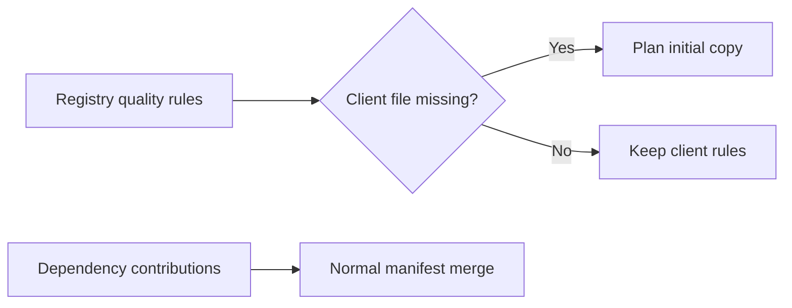
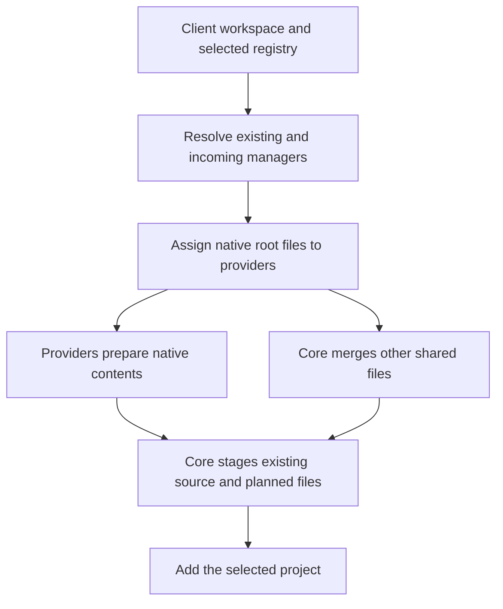
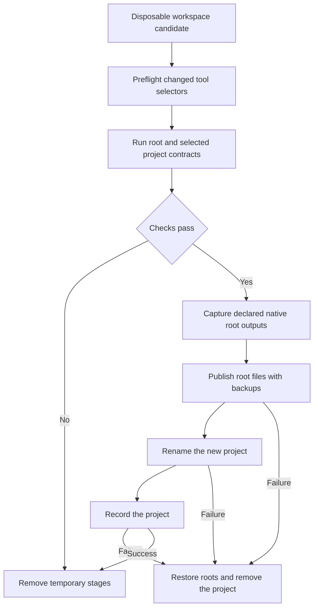

# Generate Module

## Purpose

The generate module turns a registry template into a validated workspace project. It owns questionnaire answers, merge planning, candidate staging, validation, publication, and rollback. Package-manager providers own native manifest rules.

## Design

### Usage

The CLI uses the complete workflow:

```go
err := core.Generate(ctx, cwd, selector, core.GenerateOptions{
    Questionnaire: core.InteractiveQuestionnaire{},
}, output)
```

Library callers register their package-manager backends before generating. They can also prepare a plan and apply it once:

```go
plan, err := core.BuildGeneratePlan(core.GenerateParameters{
    WorkspaceName:          "project",
    PackageManagers:        []string{"go"},
    RegistryRoot:           registry,
    RegistryWorkspaceFiles: []string{".gitignore"},
    TemplateRoot:           filepath.Join(registry, "templates", "premise-go-lib"),
    ClientRepoRoot:         workspace,
    ProjectPath:            "libs/billing",
    TemplateKind:           "lib",
    Substitutions: map[string]string{
        "example.com/premise-module": "github.com/acme/project",
        "premise-go-lib":            "billing",
    },
})
if err != nil {
    return err
}
return core.ApplyGeneratePlan(ctx, plan, output)
```

### API

| API | Use |
| --- | --- |
| `GenerateOptions` | Supply questionnaire and conflict resolution. |
| `Generate(ctx, cwd, selector, options, output)` | Resolve inputs, generate, and record the project. |
| `GenerateParameters` | Supply roots, client identity, configured managers, paths, substitutions, and conflict handling. |
| `BuildGeneratePlan(parameters)` | Prepare staged project content and unique root-file edits without publishing them. |
| `GeneratePlan` | Hold root entries, merged Mise configuration, original native files, and private staging state. |
| `ApplyGeneratePlan(ctx, plan, output)` | Validate and publish a prepared plan; remove its temporary stages on success or failure. |
| `ResolveSubstitutions(template, answers)` | Convert answers into literal replacement values. |

## Implementation Details

### Workspace initialization

Registries can declare `workspace_init_files` for initial workspace rules. Missing files are copied to the client root. Existing files remain under client control, including their permissions.

| Declaration | First project | Later projects |
| --- | --- | --- |
| `workspace_init_files` | Copy missing quality rules. | Keep existing client rules. |
| `workspace_files` | Copy or merge shared files. | Merge dependency and workspace contributions. |



### Ownership and staging



`Generate` combines configured client managers with incoming registry managers. Registration makes a backend available; configuration selects it. A provider without applicable native input returns no edits. Lower-level callers select managers explicitly.

Core routes declared native files to their owner before generic merging. Each native path has one owner and one output. Overlapping claims, duplicate outputs, traversal, and unclaimed outputs fail before publication. Other shared files retain typed Mise merging, ordered ignore-file merging, and ordinary whole-file conflict handling.

Core copies existing source and configuration into every candidate, including sibling packages and hidden native configuration. It excludes Git/Difflab metadata, generation stages, dependency caches, and build outputs. Unsupported source symlinks produce an error. Native providers reject unsupported absolute or out-of-root local dependency paths so validation cannot accidentally resolve those dependencies from the live workspace.

### Validation and publication



Tool preflight and final validation use separate disposable copies. When the root supplies the full contract set, validation runs it. Otherwise it installs Mise tools and runs a root `install` task if declared. It then runs selected-project contracts with `PREMISE_TEMPLATE_TEST=1`. Native commands belong in Mise tasks. Successful command output stays hidden; failures include useful diagnostics.

After successful checks, core captures provider-owned root manifests, lockfiles, and checksums from the final candidate. Existing client files supply the starting state; registry-development lockfiles do not. Incidental edits to existing sibling sources are discarded. Candidate dependency caches are not installed into the live workspace: run `pm install` to install live project dependencies. A root `install` task is optional; project install contracts still run.

Root publication retains original bytes and modes for rollback. If later publication or project registration fails, core restores root files and removes the new project. Only the project's same-filesystem rename is atomic; the complete operation is not a crash-safe transaction.

The module uses [Configuration](configuration.md), [Registry](registry.md), [Project](project.md), [Task](task.md), and [Package Manager](package-manager.md). Registry resolves sources; Generate owns generation and records its result.
