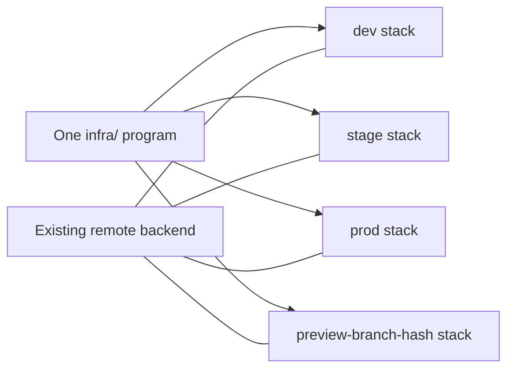
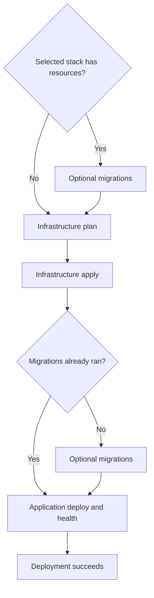

# Infrastructure module

Premise runs client-owned Pulumi code and application tasks in a defined order. A program is the code that declares resources. A stack is one instance of that program. A backend stores stack state. Clients supply an existing remote backend.

## Usage

### Create or adopt a program

```sh
pm init --infra --pulumi-lang go
pm init --infra --pulumi-lang typescript --pulumi-version 3.268.0
# Adopt an existing infra/Pulumi.yaml without changing its source files.
pm init --infra
mise run infra:install
```

Interactive initialization asks whether you need infrastructure and which language you use. A new program uses an official empty Pulumi starter. Initialization creates no resources or stack. Existing programs retain their runtime and files. A conflicting language stops initialization before writes.

Root `mise.toml` owns the Pulumi version. Initialization preserves existing tool pins unless you pass an explicit version. Change `[tools].pulumi` to select another version later. Premise runs every Pulumi command through `mise exec`. The action uses the same workspace configuration.

```text
client/
├── premise.yaml
├── mise.toml                  Pulumi pin, runtime tools, infra:install
├── infra/
│   ├── Pulumi.yaml            Project name and runtime: go
│   ├── go.mod
│   ├── go.sum
│   ├── main.go                Connect resources and export task-facing values
│   ├── database.go            Client resource declarations
│   └── storage.go             Shared by every environment stack
└── apps/
    ├── api/mise.toml          migrate, health, rollback
    ├── worker/mise.toml       migrate, health, rollback
    └── website/mise.toml      health, rollback
```

The source files belong to one Go package. File boundaries do not create stacks. A TypeScript program uses `runtime: nodejs`, `package.json`, a lockfile, and normal imports:

```text
infra/
├── Pulumi.yaml
├── package.json
├── package-lock.json
├── tsconfig.json
├── index.ts
├── database.ts
└── storage.ts
```

Premise does not register infrastructure projects or copy components from a template registry. Import shared code through your language's module system. Published providers own their resource APIs. Application and library templates remain supported.

For example, one Go declaration serves every stack:

```go
package main

import (
    "github.com/pulumi/pulumi-gcp/sdk/v9/go/gcp/storage"
    "github.com/pulumi/pulumi/sdk/v3/go/pulumi"
)

func main() {
    pulumi.Run(func(ctx *pulumi.Context) error {
        bucket, err := storage.NewBucket(ctx, "uploads", &storage.BucketArgs{Location: pulumi.String("US")})
        if err != nil {
            return err
        }
        ctx.Export("bucketName", bucket.Name)
        return nil
    })
}
```

The TypeScript equivalent uses the same logical resource name:

```ts
import * as gcp from "@pulumi/gcp";

const bucket = new gcp.storage.Bucket("uploads", { location: "US" });
export const bucketName = bucket.name;
```

Declare the SDK and provider versions in the language's dependency files. Each selected stack creates its own bucket from this code.

### Select environments and backends

Add this configuration under `workspace` in `premise.yaml`:

```yaml
infra:
  directory: infra
  backend: team
  backends:
    team:
      url: gs://existing-state-bucket/product
  environments:
    dev:
      config: {gcp:project: my-project}
    stage:
      config: {gcp:project: my-project}
    prod:
      config: {gcp:project: my-project}
    preview:
      config: {gcp:project: my-project}
```

`--backend NAME` selects a declared backend. The environment's backend overrides the workspace default. Without a named selection, set `PULUMI_BACKEND_URL`. Selection does not migrate existing state. An absolute `file://` backend requires `allow_local: true` and serves local tests.



Premise writes declared environment values to `infra/Pulumi.<stack>.yaml` through Pulumi. It preserves other keys and Pulumi secret metadata. State stays in the backend. Premise also sets `premise:environment`, `premise:branch`, and `premise:stack` configuration values.

```sh
pm infra auth
pm infra init --env dev
pm infra plan --env dev
pm infra apply --env dev --yes
pm infra output --env dev
```

These commands select the whole stack. They accept no application project argument. Use normal Pulumi dependencies inside the program.

### Create previews and shared resources

```sh
pm infra init --env preview --branch feature/login
pm infra apply --env preview --branch feature/login --yes
pm infra destroy --env preview --branch feature/login
```

If you omit `--branch`, Premise reads the current feature branch. The branch produces a stable stack name with a hash. No new source code or environment declaration is required. Preview destruction removes that stack and can run again safely. Persistent stack destruction requires interactive confirmation.

Use `--shared` explicitly for a shared stack. An optional `shared_directory` selects another client-owned program. The environment program can read shared outputs with Pulumi's normal stack references. Environment updates and preview cleanup do not select shared stacks.

### Query saved state

```sh
pm infra query --env stage --output databaseUrl --show-secrets
pm infra query --env stage --resource uploads --property arn
pm infra query --env preview --branch feature/login --resource uploads --property id
pm infra query --env stage --resource uploads --property urn --json
```

Queries read the selected stack's saved state without applying or refreshing resources. Select exactly one output or resource. Resource selectors accept a logical name or full URN. If a logical name matches several resources, use the full URN or add `--type`. Properties include `id`, `urn`, `type`, and dotted output paths. A missing or ambiguous selection returns a nonzero exit code.

Strings print as plain text. Other values print as JSON. `--json` also quotes string values. Secret values require `--show-secrets`. Treat its output as a credential and keep it out of logs.

### Declare optional migrations

Each application declares its own `migrate` task in its `mise.toml`. Premise discovers this task without running it. Applications without the task produce no migration job.

```toml
# apps/api/mise.toml
[tasks.migrate]
run = "./scripts/migrate"
```

Premise runs `mise run migrate -- ENVIRONMENT` from the application directory. The script receives the environment as its first argument. `PM_BRANCH` identifies a preview branch. The application owns its migration tool, credentials, migration history, and resource queries:

```sh
#!/usr/bin/env bash
set -euo pipefail
scope=(--env "$1")
if [[ "$1" == preview ]]; then scope+=(--branch "$PM_BRANCH"); fi
export DATABASE_URL
DATABASE_URL="$(pm infra query "${scope[@]}" --output databaseUrl --show-secrets)"
exec bun run db:migrate
```

Migration tasks select their inputs through saved infra queries. Pulumi configures deployed secret bindings. Local and E2E env files come from the project secrets:pull task. Use [secret management](../secret-management.md) explicitly for local application credentials. CI supplies the variables that the application task needs.

### Order migrations, infrastructure updates, and deployment

Clients apply database infrastructure changes separately before schema migrations. Premise does not select database resource targets or provision prerequisites.

`pm migrate --env ENV` runs optional application migration tasks. Independent groups run concurrently; explicit shared groups run their tasks in order. Premise waits for every worker before returning a failure. `pm infra plan` previews the stack, and `pm infra apply --yes` updates it. `pm deploy` runs application deployment and health tasks. It does not migrate or update infrastructure.

The environment CI flow coordinates those operations:



Existing environments migrate before the update. New environments apply first, then migrate. This first-apply path lets feature branches create previews from the same program without new code. If Pulumi creates the app itself, clients must account for it starting before that first migration. Applications without a `migrate` task do not run migrations.

```yaml
workspace:
  deployment:
    applications:
      - project: web
        deploy: deploy
        health: health
        rollback: rollback
```

The `deploy` task is optional when Pulumi deploys the application. Health and rollback tasks belong to the client. A static app can use Pulumi to create a bucket and a Mise deploy task to upload its files. A migration task receives the environment argument and can query saved infrastructure through `pm infra query`.

```sh
pm migrate --env stage
pm infra plan --env stage
pm infra apply --env stage --yes
pm deploy --env stage --release COMMIT_SHA
```

To run the equivalent sequence locally:

```sh
export PM_RELEASE=COMMIT_SHA
pm ci flow on-deploy --environment stage
```

For a feature-push preview, run `pm ci flow on-commit --environment preview --branch FEATURE_BRANCH --release none`. Cleanup uses `pm ci flow on-merge --environment preview --branch FEATURE_BRANCH --release none`. The on-deploy workflow remains manual-only. Use `--backend NAME` to override the configured backend. Child tasks inherit `PM_INFRA_BACKEND`, so their infra queries use the same selection. The flow uses the same public module operations as the individual commands. It waits for every migration worker. Hosted CI serializes the environment, and Pulumi locks infrastructure state during updates. A failed migration or infrastructure update stops the sequence. A failed application deploy or health check calls the client rollback task. The original flow still fails after successful application rollback. Premise does not run down migrations.

### Application rollback and infrastructure failures

Terraform and Pulumi do not automatically undo a failed infrastructure update. Fix the failure and apply again, or revert the code, review the new preview, and apply against the current state. Restoring an older state file does not restore real cloud resources.

`pm deploy` invokes each application's client-owned rollback task if deploy or health fails. The task uses the platform's previous revision or immutable artifact history. Premise does not keep an artifact ledger or recovery state machine. A successful rollback does not turn the failed deployment green. If rollback changes a Pulumi-managed setting, update the desired configuration before the next apply.

Infrastructure and migration failures stop the pipeline. They do not trigger application rollback or database down migrations. Pulumi owns state locking. The hosted workflows serialize each environment with GitHub concurrency groups.

## API

| API | Responsibility |
| --- | --- |
| `InitializeWorkspaceWithInfrastructure` | Initialize client-owned infrastructure with the workspace. |
| `SetupInfrastructure` | Add a client program and missing workflow while preserving client files. |
| `PrepareInfrastructure` | Install program dependencies and select the environment stack. |
| `InfrastructureExists` | Check whether the selected stack has saved application resources. |
| `RunInfra` | Preview, apply, query, or destroy infrastructure through pinned Pulumi. |
| `QueryInfrastructure` | Read a selected saved output or resource property. |
| `PlanMigrations` / `RunMigrations` | Discover optional tasks and run independent groups. |
| `RunApplicationDeployment` | Deploy and check applications, with client rollback on failure. |
| `RunDeployment` | Run the local equivalent of the separate hosted environment steps. |

The Pulumi process boundary lives in `core/extensions/pulumix.go`. Infrastructure operations, setup, and queries live in `core/infra.go`. Application deployment and rollback task execution live in `core/deploy.go`. Provider authentication, CI output adapters, and storage operations live under `core/providers`.

## Validation

The single live fixture is a static app and a small Go GCS program. The test uses `pm ci` flows across dev, stage, prod, and a branch preview. Infra apply creates a bucket; deploy uploads the static app; a fake migration writes a marker. A failed B health check must restore the retained A page while preserving B's migration marker. The test also checks environment isolation, named backend selection, fresh-checkout state reuse, and final cleanup. CLI tests use real fnox JSON files locally and in CI mode. They test temporary-file cleanup and ignored env files. The live flow combines JSON secrets with the selected bucket query in each environment. See the [static GCS fixture](../../e2e/testdata/pulumi/README.md).
