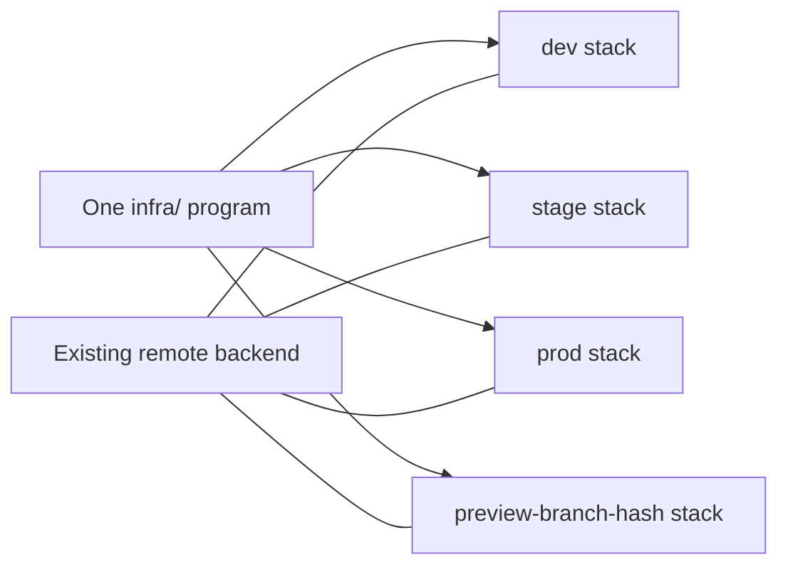
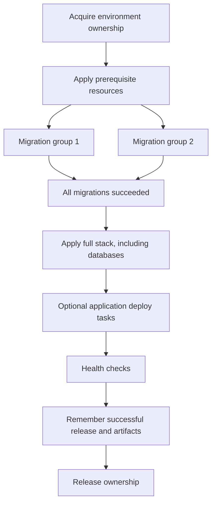

# Infrastructure module

Premise runs client-owned Pulumi code and application tasks in a defined order.
A program is the code that declares resources. A stack is one instance of that program.
A backend stores stack state. Clients supply an existing remote backend.

## Usage

### Create or adopt a program

```sh
pm init --infra --infra-language go
pm init --infra --infra-language typescript --pulumi-version 3.268.0
# Adopt an existing infra/Pulumi.yaml without changing its source files.
pm init --infra
mise run infra:install
```

Interactive initialization asks whether you need infrastructure and which language you use.
A new program uses an official empty Pulumi starter. Initialization creates no resources or stack.
Existing programs retain their runtime and files. A conflicting language stops initialization before writes.

Root `mise.toml` owns the Pulumi version. Initialization preserves existing tool pins unless you pass an explicit version.
Change `[tools].pulumi` to select another version later. Premise runs every Pulumi command through `mise exec`.
The action uses the same workspace configuration.

```text
client/
├── premise.yaml
├── mise.toml                  Pulumi pin, runtime tools, infra:install
├── infra/
│   ├── Pulumi.yaml            Project name and runtime: go
│   ├── go.mod
│   ├── go.sum
│   ├── main.go                Connect resources and export task-facing values
│   ├── database.go            Client resource declarations
│   └── storage.go             Shared by every environment stack
└── apps/
    ├── api/mise.toml          migrate, health, rollback
    ├── worker/mise.toml       migrate, health, rollback
    └── website/mise.toml      health, rollback
```

The source files belong to one Go package. File boundaries do not create stacks.
A TypeScript program uses `runtime: nodejs`, `package.json`, a lockfile, and normal imports:

```text
infra/
├── Pulumi.yaml
├── package.json
├── package-lock.json
├── tsconfig.json
├── index.ts
├── database.ts
└── storage.ts
```

Premise does not register infrastructure projects or copy components from a template registry.
Import shared code through your language's module system. Published providers own their resource APIs.
Application and library templates remain supported.

For example, one Go declaration serves every stack:

```go
package main

import (
    "github.com/pulumi/pulumi-aws/sdk/v7/go/aws/s3"
    "github.com/pulumi/pulumi/sdk/v3/go/pulumi"
)

func main() {
    pulumi.Run(func(ctx *pulumi.Context) error {
        bucket, err := s3.NewBucket(ctx, "uploads", &s3.BucketArgs{})
        if err != nil {
            return err
        }
        ctx.Export("bucketName", bucket.Bucket)
        ctx.Export("bucketArn", bucket.Arn)
        return nil
    })
}
```

The TypeScript equivalent uses the same logical resource name:

```ts
import * as aws from "@pulumi/aws";

const bucket = new aws.s3.Bucket("uploads");
export const bucketName = bucket.bucket;
export const bucketArn = bucket.arn;
```

Declare the SDK and provider versions in the language's dependency files.
Each selected stack creates its own bucket from this code.

### Select environments and backends

Add this configuration under `workspace` in `premise.yaml`:

```yaml
infra:
  directory: infra
  backend: team
  backends:
    team:
      url: s3://existing-state-bucket/product
  environments:
    dev:
      config: {aws:region: us-east-1}
    stage:
      config: {aws:region: us-east-1}
    prod:
      config: {aws:region: us-east-1}
    preview:
      config: {aws:region: us-east-1}
```

`--backend NAME` selects a declared backend. The environment's backend overrides the workspace default.
Without a named selection, set `PULUMI_BACKEND_URL`. Selection does not migrate existing state.
An absolute `file://` backend requires `allow_local: true` and serves local tests.



Premise writes declared environment values to `infra/Pulumi.<stack>.yaml` through Pulumi.
It preserves other keys and Pulumi secret metadata. State stays in the backend.
Premise also sets `premise:environment`, `premise:branch`, and `premise:stack` configuration values.

```sh
pm infra auth
pm infra init --env dev
pm infra plan --env dev
pm infra apply --env dev --yes
pm infra output --env dev
```

These commands select the whole stack. They accept no application project argument.
Use normal Pulumi dependencies inside the program.

### Create previews and shared resources

```sh
pm infra init --env preview --branch feature/login
pm infra apply --env preview --branch feature/login --yes
pm infra destroy --env preview --branch feature/login
```

If you omit `--branch`, Premise reads the current feature branch.
The branch produces a stable stack name with a hash. No new source code or environment declaration is required.
Preview destruction removes that stack and can run again safely. Persistent stack destruction requires interactive confirmation.

Use `--shared` explicitly for a shared stack. An optional `shared_directory` selects another client-owned program.
The environment program can read shared outputs with Pulumi's normal stack references.
Environment updates and preview cleanup do not select shared stacks.

### Query saved state

```sh
pm infra query --env stage --output databaseUrl --show-secrets
pm infra query --env stage --resource uploads --property arn
pm infra query --env preview --branch feature/login --resource uploads --property id
pm infra query --env stage --resource uploads --property urn --json
```

Queries read the selected stack's saved state without applying or refreshing resources.
Select exactly one output or resource. Resource selectors accept a logical name or full URN.
If a logical name matches several resources, use the full URN or add `--type`.
Properties include `id`, `urn`, `type`, and dotted output paths.
A missing or ambiguous selection returns a nonzero exit code.

Strings print as plain text. Other values print as JSON. `--json` also quotes string values.
Secret values require `--show-secrets`. Treat its output as a credential and keep it out of logs.

### Declare optional migrations

Each application declares its own `migrate` task in its `mise.toml`.
Premise discovers this task without running it. Applications without the task produce no migration job.

```toml
# apps/api/mise.toml
[tasks.migrate]
run = "./scripts/migrate"
```

Premise runs `mise run migrate -- ENVIRONMENT` from the application directory.
The script receives the environment as its first argument. `PM_BRANCH` identifies a preview branch.
The application owns its migration tool, credentials, migration history, and resource queries:

```sh
#!/usr/bin/env bash
set -euo pipefail
scope=(--env "$1")
if [[ "$1" == preview ]]; then scope+=(--branch "$PM_BRANCH"); fi
export DATABASE_URL
DATABASE_URL="$(pm infra query "${scope[@]}" --output databaseUrl --show-secrets)"
exec bun run db:migrate
```

Premise does not map infrastructure outputs to migration inputs or load fnox automatically for these tasks.
Use [secret management](../secret-management.md) explicitly for local application credentials.
CI supplies the variables that the application task needs.

### Order provisioning, migrations, and deployment

Declare database prerequisite targets and application contracts under `workspace`:

```yaml
infra:
  directory: infra
  # Include resource dependencies that must exist before migrations.
  prerequisites: ["*::database"]
  # Keep backend and environment declarations from the earlier example.
deployment:
  applications:
    - project: api
      health: health
      rollback: rollback
    - project: worker
      health: health
      rollback: rollback
    - project: website
      health: health
      rollback: rollback
  # Optional: serialize these tasks when they share migration history.
  migration_groups:
    shared-history: [api, worker]
  recovery:
    first_deploy: {project: api, task: cleanup}
```

Independent migrating applications get separate jobs by default.
An explicit group runs its members in order within one job.
A migrating application requires declared prerequisites. Premise does not infer database resources from arbitrary code.
Prerequisite selection includes the required providers and component parents. Other dependencies require explicit targets.



An application can set `deploy: deploy` when the full infrastructure update does not deploy it.
The health and rollback tasks remain explicit. Task arguments use the same environment contract as migrations.

```sh
pm deploy plan --env stage --json
pm deploy run --env stage --release COMMIT_SHA \
  --artifact api=IMMUTABLE_REFERENCE,worker=IMMUTABLE_REFERENCE,website=IMMUTABLE_REFERENCE
```

Artifact references identify retained builds, image digests, or provider deployment IDs.
The client publishes and retains those artifacts. Premise stores references and does not upload local build directories.
Keep the previous release's artifacts available until recovery no longer needs them.

### Recover from failure

A failed migration prevents the full update. Applied migrations remain in place.
Clients must make migrations backward compatible and own database repair.
For a partial update or failed health check, Premise refreshes state and invokes client rollback tasks.
First-release cleanup runs when no successful release exists.
Optional `recovery.provision`, `recovery.migration`, and `recovery.database` tasks handle client-specific repairs.

Tasks receive `PM_ENV`, `PM_BRANCH`, `PM_STACK`, `PM_RUN_ID`, `PM_RELEASE`, and JSON `PM_ARTIFACTS`.
Recovery also receives `PM_FAILED_PHASE`, `PM_PREVIOUS_RELEASE`, JSON `PM_PREVIOUS_ARTIFACTS`, and JSON `PM_PREVIOUS_OUTPUTS`.
Use these references to restore the application. Do not undo compatible schema migrations automatically.

Successful metadata lives under `BACKEND/.premise-releases/PROJECT/STACK` by default.
Set `deployment.records` to another `s3://` or `gs://` prefix when needed.
The destination must support conditional object writes and deletion. The AWS CLI or gcloud must be available through Mise.
An explicit local directory supports tests and local operation. Remote-backend CI rejects runner-local records.

```text
.premise-releases/PROJECT/STACK/
├── lock.json                  Owner of the entire deployment
├── last-success.json          Release and retained artifact references
├── last-run.json              Original outcome and recovery outcome
└── runs/
    ├── RUN_ID.json            Phase state and previous recovery references
    └── RUN_ID/migrations/
        └── GROUP.json         One worker's outcome
```

These records describe application releases. Pulumi resource state does not store this application contract.
A failed release cannot replace the previous successful record. Records contain no application credentials.
The shared lock covers every phase and blocks overlapping standalone infrastructure changes.
Failed recovery retains ownership so another release cannot hide the failure.

For an interrupted run, stop every worker before repair.
Inspect its run and migration records. A migration still marked `running` blocks automatic recovery.
Use `pm deploy recover --env ENV --run-id ID` when workers report completion.
If a stopped worker left a running marker, add `--workers-stopped` only after every worker stops.
After manual repair, `pm deploy unlock --env ENV --run-id ID` releases only that run's lock.
For previews, also pass the original `--branch`.

### Add infrastructure later

`pm init` without infrastructure omits `on-deploy.yml` and does not add a Pulumi tool pin.
Run `pm infra setup --language go` in that workspace to create the official starter, add infrastructure configuration, and add the missing manual workflow.
Use `--pulumi-version VERSION` to select the tool pin. Omit `--language` to adopt an existing `infra/Pulumi.yaml` program.
Setup preserves existing programs, client tasks, tool pins, and workflows. Repeating it adds only missing files.
Configure a remote backend before using `pm infra init --env ENV`; setup does not create cloud resources or initialize stacks.

### Run CI phases

`deployment.yml` is the reusable job graph. Each job selects the same commit, backend, environment, and run ID.
Its optional `directory` input selects a workspace below the checkout root.
`revision` selects the source commit. `deployment-revision` can identify a different immutable application release.
Use `run-id` when one workflow run performs more than one deployment. Each deployment needs its own ID.
Fresh runners restore declared stack configuration. Migration workers write separate outcomes to shared storage.
The full update waits for all workers. A zero-migration deployment skips the matrix and continues directly.
Recovery waits for all migration jobs, including failed jobs.

The CLI exposes `deploy start`, `provision`, `migrate --group NAME`, `apply`, `complete`, and `recover`.
`deploy run` calls these same phases locally. The action exposes matching `deploy-*` commands.
CI must not run `deploy run` after the migration matrix because it repeats the deployment lifecycle.

`on-deploy.yml` remains manual. Feature pushes create previews through `on-commit.yml`.
Merge and branch-deletion events clean previews through `on-merge.yml`.
Pull-request validation does not deploy. Cleanup never publishes a release.
Package publication and credential preflight do not select GitHub environments. Store publication tokens as repository or organization CI secrets. Environment-scoped jobs are for actual infrastructure deployments.

## API

| API                                     | Responsibility                                                             |
| --------------------------------------- | -------------------------------------------------------------------------- |
| `InitializeWorkspaceWithInfrastructure` | Stage workspace files and create or adopt a client program.                |
| `SetupInfrastructure`                   | Add infrastructure to an existing workspace and preserve client files.     |
| `ResolveStackName`                      | Resolve persistent, preview, or explicitly shared stack identity.          |
| `ResolveInfrastructure`                 | Resolve program directory, backend, and environment configuration.         |
| `RunInfra`                              | Run pinned Pulumi operations and respect deployment ownership.             |
| `QueryInfrastructure`                   | Select a non-secret or explicitly requested secret value from saved state. |
| `PlanMigrations`                        | Discover optional application tasks and ordered groups.                    |
| `ResolveDeploymentPlan`                 | Describe phases, migration jobs, and durable record destinations.          |
| `RunDeploymentPhase`                    | Execute one phase using the shared run identity.                           |
| `RunDeployment`                         | Run phases locally and attempt client recovery after failure.              |

`core/pulumix.go` owns CLI invocation and Pulumi plan/state wire formats.
`core/providers` owns provider authentication, credentials, and object storage operations.
Core imports no cloud resource SDK. Client fixture modules own their published provider dependencies.

## Validation

Premise's end-to-end harness exercises real Go and TypeScript programs, saved-state queries, PostgreSQL migrations, and automatic artifact recovery.
The live S3 test creates two isolated preview buckets and managed objects. It checks state reuse and cleanup isolation.
Cloud checks require explicit test credentials. A skipped check is not live validation.
See the [S3 fixture](../../e2e/testdata/pulumi/README.md) and [local deployment fixture](../../e2e/testdata/deploy/README.md) and [live Neon/Vercel fixture](../../e2e/testdata/neon-vercel/README.md).
