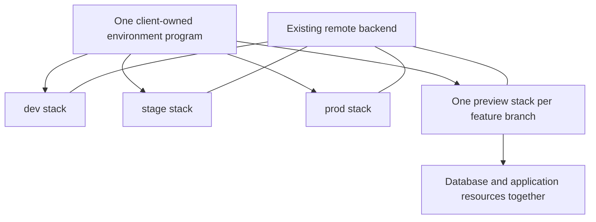
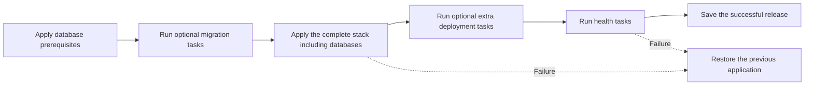
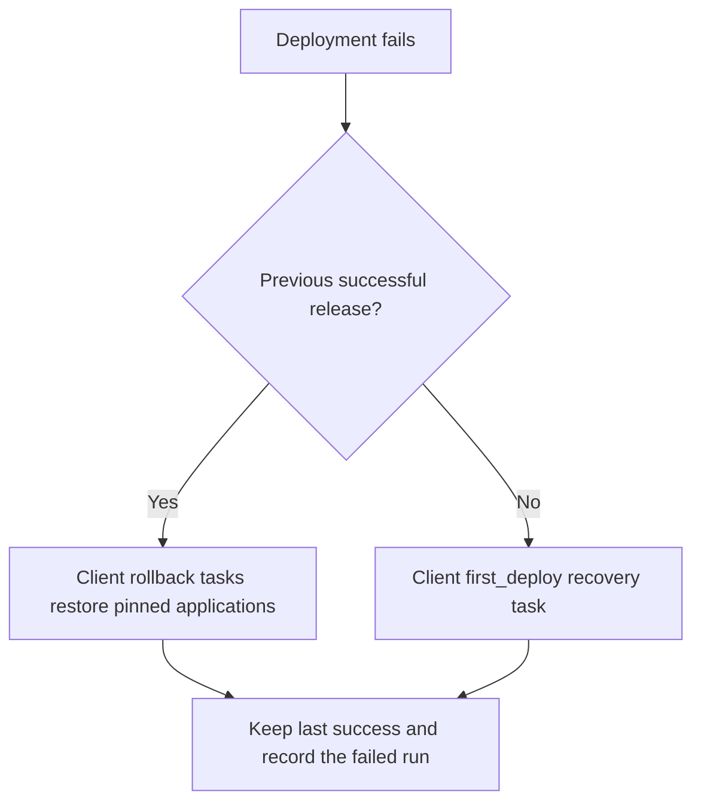
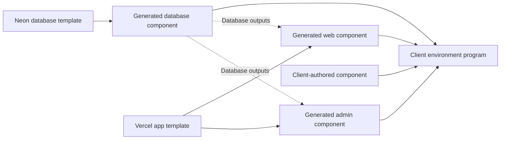

# Infrastructure Module

## Purpose

The infrastructure module invokes Pulumi for an explicit environment and connects project-owned tasks to the deployment lifecycle. Pulumi owns resource dependencies, provider configuration, state, and secret outputs. A program declares resources; a stack is an instance of that program; a component groups resources in the program.

## Design

### Stack ownership



### Usage

#### Configure an environment

Use one program for each environment's infrastructure. Its `dev`, `stage`, `prod` and feature-branch preview stacks have separate state. The program contains database and application resources. A shared program can own resources outside these environments.

```yaml
workspace:
  infra:
    bindings:
      web: {program: environment, artifact: .}
  projects:
    - name: environment
      path: infra/environment
      infra: {role: program, scope: environment}
```

Set `PULUMI_BACKEND_URL` to an existing remote backend. Provider SDKs read normal Pulumi configuration and environment variables. Environment maps and cloud project declarations are optional in `premise.yaml`.

For saved backend choices, declare `workspace.infra.backends` and select one with `--backend NAME`. Environment or workspace defaults can select a saved backend. Explicit selection takes precedence over the ambient URL. Optional `environments.ENV.config` supplies non-secret values at initialization. Normal `Pulumi.STACK.yaml` configuration also works.

The backend must exist before initialization. Hosted deployments use a configured remote DIY backend. Local tests can use an absolute `file://` URL with `allow_local: true`. A backend selection changes the state destination. It does not migrate existing state.

```sh
pm infra init --env dev
pm infra plan --env dev
pm infra apply --env dev --yes
pm infra output --env dev
pm infra test
```

A client-owned component needs a project declaration only when Premise should run its task contracts or select its resource targets. It does not need a registry template identifier.

```yaml
workspace:
  projects:
    - name: client-resources
      path: infra/components/client
      infra: {role: component}
```

Import the component from the environment program through the language's normal module imports. The Neon/Vercel example demonstrates this composition.

The project argument is optional. Omitting it selects the complete program for the environment. Selecting a component uses its declared resource targets in the same stack. A component does not receive its own stack.

```sh
pm infra bind web environment --artifact .output
pm infra plan --env preview --branch feature/example
```

The binding connects the app's artifact path to the program. Initialization supplies `premise:bindings` and an `artifacts` map to the program. A template must consume its declared inputs.

#### Deploy in order



Declare the database prerequisite targets and migration task in `workspace.deployment`. Targets identify resource URNs, which are Pulumi's unique resource names. They can contain `{stack}` and `{project}` placeholders. Premise inspects the full preview graph before the targeted update.

```yaml
workspace:
  deployment:
    records: .premise-releases
    record_outputs: [deploymentId, appURL]
    prerequisites:
      - "urn:pulumi:{stack}::{project}::*::db-*"
    migrations:
      - project: web
        task: migrate
        outputs: {DATABASE_URL: databaseURL}
    applications:
      - project: web
        health: health
        rollback: rollback
        outputs: {APP_URL: appURL}
    recovery:
      first_deploy: {project: web, task: cleanup}
```

Include all resources that the database needs in the prerequisite declaration. Premise includes required provider and parent resources. It rejects dependencies outside the selected set. Do not include application resources before the migration barrier.

```sh
pm deploy plan --env stage
pm deploy run --env stage --release COMMIT_SHA --artifact web=IMMUTABLE_ARTIFACT_ID
```

The executor follows this order through initialization, updates, task hooks, and health checks. Pulumi deploys apps by default. Add a `deploy` task only for work outside Pulumi.

Omit `migrations` when the project has no migration task. An app declares a `deploy` task only when Pulumi does not deploy it:

```yaml
applications:
  - project: web
    deploy: deploy
    health: health
    rollback: rollback
    outputs: {APP_URL: appURL}
```

Keep this declaration inside `workspace.deployment`, with the recovery and record settings above. The infrastructure program must not deploy the same app. Use `--backend NAME` to select another declared backend for an operation.

Migration tasks receive declared stack outputs and application values in their environment. They also receive `PM_ENV`, `PM_BRANCH`, `PM_STACK`, `PM_RELEASE`, and `PM_ARTIFACTS`. The migration tool owns schema history and locking. See [Secret management](../secret-management.md) for local fnox profiles and CI variables.

#### Recover from failure



The client must keep migrations compatible with the running application. Premise does not infer a down migration. A database recovery task can restore a backup or perform client-defined compensation.

After a rollout or health failure, Premise runs the declared rollback tasks. They receive the previous successful release and artifact identities. `PM_PREVIOUS_OUTPUTS` supplies declared non-secret deployment identities, such as the previous Vercel deployment ID. A task that changes Pulumi resources must preview its targeted recovery first. It must not reapply old database definitions or rerun old migrations.

Declare `first_deploy` recovery for a rollout without a previous release. Optional `provision`, `migration`, and `database` hooks handle other failure phases. Recovery does not fetch application secrets automatically. A hook resolves any required values explicitly. Failed recovery reports both errors and preserves the previous successful record.

The release record stores the previous successful release and artifact IDs. Pulumi state describes the current resources, including partial changes after failure. It cannot identify which full deployment passed migrations and health checks. Program, stack, and backend fields prevent restoring a record from another destination. The record does not copy Pulumi configuration or resource state.

The record directory contains `last-success.json` and `last-run.json` under `PROGRAM/STACK`. This keeps different programs separate when they share a backend. It contains no secret output values. Store the directory durably across CI runners. The composite action restores and saves records in a GCS prefix. `records-url` can select a prefix separate from the state backend. The action appends the program and stack names to that prefix.

The deployment holds a local lock through both updates, migrations and recovery. CI concurrency must serialize that whole sequence with cancellation disabled. Pulumi's backend lock covers each update separately. It does not lock the migration task.

#### Compose template components



Registry templates contain Go project components built with published Pulumi providers. A Neon database template and a Vercel application template are separate components. Neither is a new provider. Premise renders their names and declared questionnaire substitutions when it scaffolds each project.

```text
registry/
  premise.yaml                         # template declarations and questions
  templates/neon-db/
    component.go                       # Go ComponentResource using Neon SDK
    go.mod, go.sum, mise.toml
  templates/vercel-app/
    component.go                       # Go ComponentResource using Vercel SDK
    go.mod, go.sum, mise.toml

client/
  premise.yaml                         # projects, bindings, optional task hooks
  apps/web/                            # project Mise tasks and app source
  apps/admin/
  infra/environment/
    Pulumi.yaml                        # one Go program, not one program per app
    main.go                            # imports and composes the components
    go.mod, go.sum, mise.toml
    fnox.toml                          # program's selected secret references
    Pulumi.dev.yaml                    # normal Pulumi configuration, when used
  infra/components/database/           # generated Neon component
  infra/components/web-deployment/     # generated Vercel component instance
  infra/components/admin-deployment/   # another instance of the same template
  infra/components/client/             # component authored by the client
```

Generate the Vercel template twice with distinct names and Go module paths. Import both modules and give their constructors distinct Pulumi resource names. You can also instantiate one rendered component twice. Bind each app’s source path separately. Connect the database output to both apps through normal Pulumi outputs.

```sh
pm g REGISTRY:neon-db --answer name=database
pm g REGISTRY:vercel-app --answer name=web-deployment
pm g REGISTRY:vercel-app --answer name=admin-deployment
pm infra bind web environment --artifact .
pm infra bind admin environment --artifact .
pm infra init --env preview
pm infra plan --env preview
pm infra apply --env preview --yes
```

The client owns `main.go`, imports, and component wiring. Templates can supply the initial program. `pm infra test` runs its declared test tasks. The [GCS fixture](../../e2e/testdata/pulumi/README.md) exercises the infrastructure CLI against a private live bucket.

### API

| API                                            | Responsibility                                             |
| ---------------------------------------------- | ---------------------------------------------------------- |
| `InfraStack(options)`                          | Resolve a persistent or branch-specific stack identity.    |
| `ResolveInfrastructure(root, options)`         | Select the program, backend, config, and resource targets. |
| `RunInfra(ctx, root, operation, options, ...)` | Invoke Pulumi init, plan, apply, output, or destroy.       |
| `BindInfra(root, app, program, artifact)`      | Save an app path binding to one program.                   |
| `TestInfrastructure(ctx, root, project, ...)`  | Run project-owned infra tests.                             |
| `PlanDeployment` / `ResolveDeploymentPlan`     | Report task order and recovery-record destination.         |
| `RunDeployment(ctx, root, options, ...)`       | Apply infra with optional task hooks and failure recovery. |

Provider authentication uses `InfrastructureProvider(name)`, `InfraProvider.EnsureEnvironment(ci)`, and `InfraProvider.Authenticate(...)`. `AuthenticateInfrastructure` runs declared native providers before the root fallback. `EnsureInfrastructureEnvironment` checks required variables before infrastructure work.

Infra commands take an optional project. Omitting it selects the complete stack. A component filter uses its declared resource targets inside that stack. `pm deploy run` updates the complete environment, so it does not take a component filter.

## Implementation Details

### Environment identities

| Environment | Pulumi stack               | Lifetime                                       |
| ----------- | -------------------------- | ---------------------------------------------- |
| `dev`       | `dev`                      | Persistent development infrastructure.         |
| `stage`     | `stage`                    | Persistent release validation infrastructure.  |
| `prod`      | `prod`                     | Persistent production infrastructure.          |
| `preview`   | `preview-BRANCH_SLUG-HASH` | One isolated stack per feature branch.         |
| `--shared`  | `shared`                   | Optional resources outside environment stacks. |

`InfraStack` lowercases the branch, replaces unsupported characters with hyphens, limits the slug to 40 characters, and appends the first five SHA-256 bytes of the original branch. Thus `feature/a` and `feature-a` have separate stacks. Repeated pushes use the same identity; deletion supplies the original branch to destroy it. The CLI infers the current branch when `--env preview` omits `--branch`.

Initialization selects or creates that stack and supplies `premise:environment`, `premise:branch`, `premise:stack`, `premise:bindings`, and the program's `artifacts` map. These are runtime parameters for the same program. Provider accounts, project IDs, and regions remain provider configuration. Declared authentication providers use `pm infra auth`.

The same program creates previews from feature-branch pushes. The configuration supplies branch identity and environment parameters. A new PR or branch-specific program is not required.

The generated workflow pins action and binary version `v0.5.0-rc.243` because it supplies the deployment interface introduced here. Move both pins together after a compatible stable release.

Set `PREMISE_DEPLOY_ENABLED=true` to enable the generated feature-branch deployment workflow. Configure backend selection and provider credentials as described in [Provider setup](../providers/README.md). Mise installs the project-selected tools. `pm infra auth --ci` authenticates declared providers before the optional root `ci:auth` fallback. The preview stack name includes a stable branch hash. Further pushes update the same stack. Set `PREMISE_SECRETS_PROVIDER` to select a native encryption provider for new stacks; existing stacks retain their provider. See [state encryption](../providers/pulumi.md).

A same-repository PR merge invokes cleanup with its head branch identity. Branch deletion also invokes cleanup, including branches without a merged PR. Cleanup is safe to repeat when the preview stack has already been removed. It removes only that preview stack. Shared resources, project containers and the state backend remain. Cleanup uses the default branch's program, so retain compatible resource definitions there.

### Interrupted deployments

A cancelled process can leave partial resource changes or an interrupted lock. It does not guarantee that recovery tasks ran. Inspect the stack, migration history and last-run record before retrying.

If a stored lock remains, identify its interrupted run before removing it. Do not overwrite a successful release record to clear a failure. Restore the previous app with its pinned inputs and current database state. Record any manual repairs and remaining resources.

### Secret environment

Declare application `secrets` keys on the program. Premise reads local fnox profiles locally and CI variables in CI. Use distinct keys for distinct apps. The program assigns them to components and marks resource inputs with `pulumi.ToSecret`. See [Secret management](../secret-management.md).

## References

- [Secret management](../secret-management.md)
- [Pulumi targeted updates](https://www.pulumi.com/docs/iac/operations/stack-management/targeted-updates/)
- [Pulumi state and backends](https://www.pulumi.com/docs/iac/concepts/state-and-backends/)
