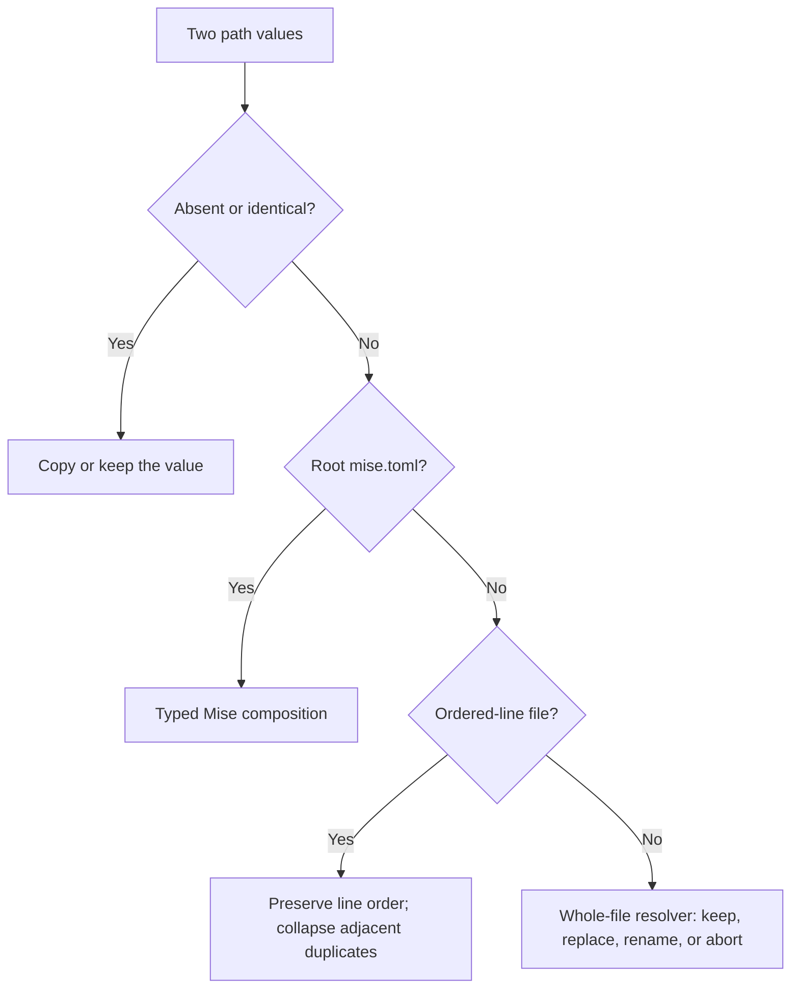
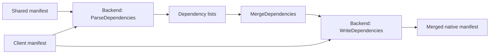
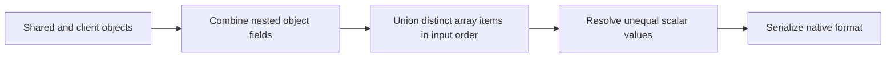

# Merge Module

## Purpose

Merge combines generation inputs without writing the destination workspace. Generate owns staging, validation, application, and rollback.

## Design

### Usage

Pass `MergeDecisions.Resolve` to `BuildGeneratePlan` for deterministic decisions. A nil resolver prompts in the terminal.

```go
decisions := core.MergeDecisions{
    "scripts.build": {Choice: core.MergeChoiceUseSelected},
}
merged, err := core.MergeJSON("package.json", shared, client, decisions.Resolve)
```

### Components

File collisions follow these tiers:



File modes resolve separately through the same decision boundary. See [Generate](generate.md) for candidate validation and rollback.

Native dependencies use a common model:



| Dependency collision                       | Result                  |
| ------------------------------------------ | ----------------------- |
| New scope and name                         | Add dependency.         |
| Equal specification                        | Keep it.                |
| Concrete versions in one major             | Keep the newer version. |
| Different majors                           | Fail.                   |
| Different ranges, paths, or native options | Ask the resolver.       |

Mise tools use this policy too. Direct Go requirements stay direct if either input declares them directly.

Backends can merge other structured settings through `MergeJSON`, `MergeTOML`, or `MergeYAML`:



### Core types and API

| API | Use |
| --- | --- |
| `PathValue`, `MergeEntry`, `MergeStrategy` | Describe inputs, output, and file merge policy. |
| `MergeConflict`, `MergeDecision`, `MergeConflictResolver` | Describe and decide a collision. |
| `MergeDecisions.Resolve` | Resolve by field key or file path. |
| `MergeJSON`, `MergeTOML`, `MergeYAML` | Merge structured settings with one object, array, and scalar policy. |
| `Dependency`, `MergeDependencies` | Combine native dependency lists by scope and name. |
| `MergeManifestDependencies` | Run a `PackageManagerBackend` through parse, merge, and write. |

## Maintainer notes

- Shared merge policy lives in `core/merge.go`; typed Mise behavior lives in `core/misex.go`.
- Native syntax and manifest validation stay in each backend file. Generic document merging does not interpret dependency versions.
- Writers preserve unrelated client values. Serialization can normalize formatting and remove comments; unchanged Cargo dependency lists preserve their original bytes.
- JSON and YAML accept one object document. Empty inputs represent an empty object. Invalid inputs fail before serialization.
