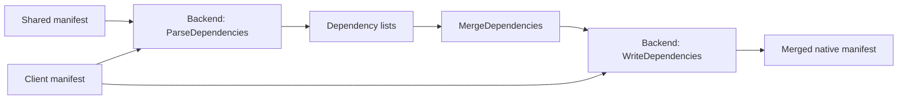

# Merge Module

## Purpose

The merge module models and resolves collisions between registry-root workspace files and selected-template contributions during generation.

## Design

### Usage

```go
decisions := core.MergeDecisions{
    ".github/workflows/ci.yml": {
        Choice: core.MergeChoiceRenameSelected,
        Rename: ".github/workflows/app-ci.yml",
    },
}

plan, err := core.BuildGeneratePlan(core.GenerateParameters{
    ResolveConflict: decisions.Resolve,
    // resolved roots and identities omitted
})
```

### API

| API | Use |
| --- | --- |
| `MergeStrategy` | Identify copy, equality, typed Mise, ordered-line, or whole-file behavior. |
| `PathValue` | Represent a file, directory, mode, content, or absent path. |
| `MergeEntry` | Record shared, selected, and resolved values for one path. |
| `MergeConflict` | Describe a decision required from a caller or user. |
| `MergeDecision` | Select shared, selected, renamed, or abort behavior. |
| `MergeConflictResolver` | Inject deterministic or interactive conflict handling. |
| `MergeDecisions.Resolve(conflict)` | Resolve tests and automation from a decision map. |
| `Dependency` | Carry a name, native scope, version, native options, and indirect flag. |
| `MergeDependencies(path, shared, selected, resolver)` | Combine dependency lists with one policy for every adapter. |
| `MergeManifestDependencies(backend, path, shared, selected, resolver)` | Parse both native manifests, merge their lists, and regenerate the client manifest. |

## Implementation Details

Generation applies three conflict tiers. Root `mise.toml` receives a typed TOML merge. Ordered-line files such as ignore files preserve stable first occurrence ordering. Other collisions require a whole-file decision and may permit renaming the selected contribution.

Absent or identical inputs collapse without prompting. File modes are resolved independently and conflicting executable modes use the same resolver boundary. A nil resolver activates the production terminal prompt; tests and non-interactive callers should inject `MergeDecisions.Resolve`.

The module computes merge results but does not mutate the destination workspace. [Generate](generate.md) stages those results, validates the complete candidate, and owns publication and rollback.

Mise, Bun, Cargo, and Go produce the same `Dependency` structs. Merge identifies a dependency by its scope and name, copies additions, keeps equal specifications, and selects newer concrete versions within one major. Different majors fail. Version ranges, local paths, and different native settings require a conflict decision. Direct Go requirements remain direct when either input declares them directly.

Backends implement `ParseDependencies` and `WriteDependencies`. They contain syntax handling and native validation, while the merge module contains list combination and conflict selection. Writers retain unrelated client settings. Unchanged Cargo dependency lists preserve the source bytes; changed lists use the native TOML serializer.


