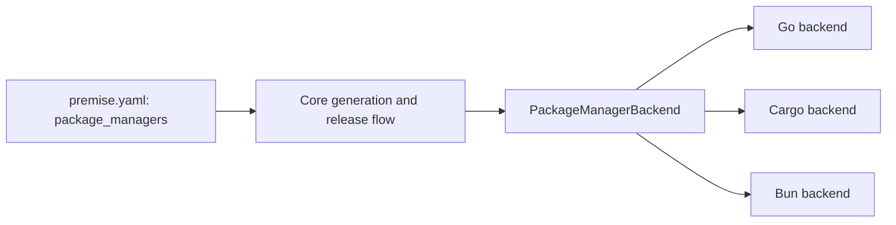
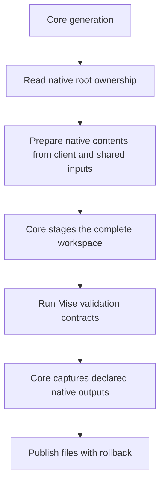
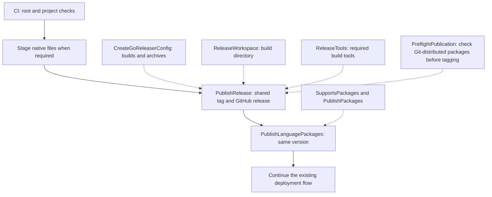
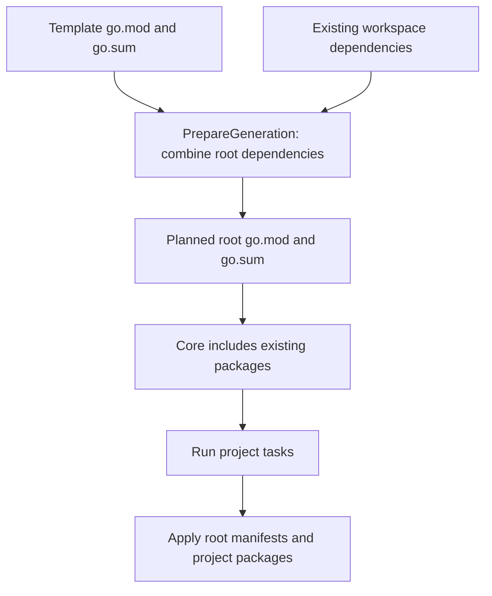
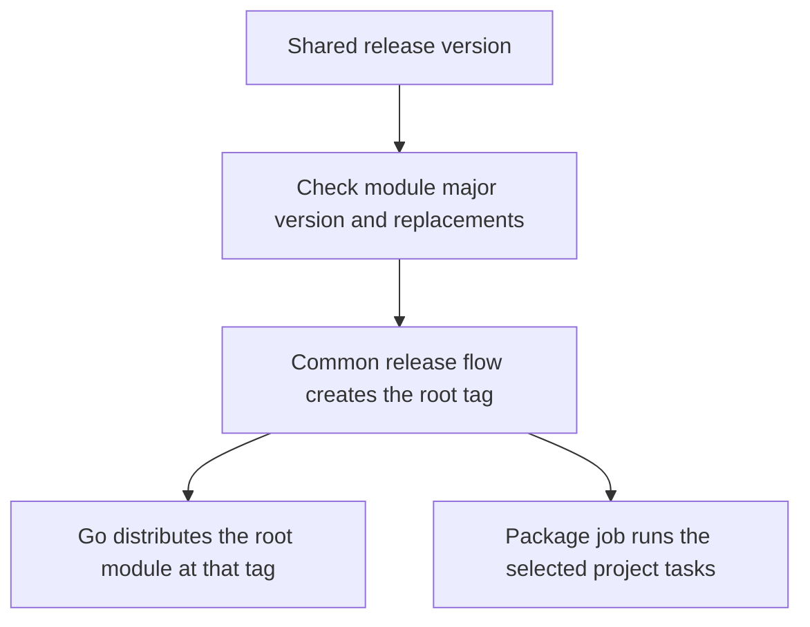

# Package Manager Module

## Purpose

The package-manager module defines how selected package ecosystems expose metadata, validate packages, contribute artifacts, and publish language packages. Core owns the contract and orchestration; `core/backends` contains built-in Go, Cargo, and Bun implementations.

## Design

### Usage

```go
if err := core.RegisterPackageManagerBackend(myBackend); err != nil {
    return err
}
```

```yaml
workspace:
  package_managers:
    - go
    - cargo
    - bun
```

The CLI registers built-ins in its composition root. Library clients register their own implementations explicitly; backends never self-register through `init`.

### API

| API | Use |
| --- | --- |
| `ParseDependencies(manifest)` | Parse native dependency sections into `[]Dependency`. |
| `WriteDependencies(manifest, dependencies)` | Regenerate native dependency sections while retaining client settings. |
| `PackageManagerBackend.ID()` | Return the value accepted by `workspace.package_managers`. |
| `PackageManagerBackend.Ecosystem()` | Return the incompatibility key, such as `npm`, `cargo`, or `go`. |
| `GetPackageMetadata(root, template)` | Parse one native package specification into `PackageMetadata`. |
| `ValidatePackage(root, template)` | Perform static package validation. |
| `WillPublishOk(ctx, root, template, version, task)` | Preflight one package without publication. |
| `PreflightPublication(ctx, root, version, task)` | Check workspace publication before changes. |
| `CreateGoReleaserConfig(root, manifest)` | Contribute GoReleaser `builds` and `archives`. |
| `SupportsPackages()` | Report whether the manager handles language packages. |
| `PublishPackages(ctx, root, version, task, ...)` | Preflight and publish eligible packages. |
| `ReleaseWorkspace(ctx, root, ...)` | Prepare the workspace used for artifact builds. |
| `RegisterPackageManagerBackend(backend)` | Register an implementation before invoking generation or release APIs. |
| `PackageManagerGeneration` | Declare native root ownership and prepare native file contents. |
| `PackageManagerReleaseTools` | Select tools for executable builds. |
| `PackageManagerRepositoryPublication` | Validate Git-distributed packages before creating the shared tag. |
| `PackageMetadata` | Carry manager-neutral package name, version, path, registry, visibility, and publication capability. |

## Implementation Details

### Interface and ownership

Premise selects providers from `workspace.package_managers`. Each provider implements `PackageManagerBackend`. Go, Cargo, and Bun use the same repository version and Git tag.



Core decides when checks, publication, and deployment run. Providers read native package files and run the commands for their package manager. A provider cannot choose a separate version for each project.

`GetPackageMetadata` reads package details. `ValidatePackage` checks those details without publication. `WillPublishOk` checks whether one package can run its publication task. `PreflightPublication` checks the selected packages as a group. The provider uses these checks inside its publication methods.

### Native workspace preparation

All three built-ins use the same optional generation capability:

```go
type PackageManagerGeneration interface {
    GenerationRootFiles() []string
    PrepareGeneration(PackageGenerationContext) ([]MergeEntry, error)
}
```



`PackageGenerationContext` supplies the client workspace name, project path, staged template, original `ClientFiles`, declared registry `SharedFiles`, existing client `ProjectPaths`, and a conflict resolver. Providers return native contents. Core attaches original values and modes, enforces unique ownership, stages existing source, and publishes validated outputs. There is no provider candidate-copy hook. Shared context helpers create root entries, reset lockfiles, match the selected project, and validate local paths. These helpers live with the existing package-manager contract. Bun and Cargo discard stale root and template lockfiles inside the candidate; native installation regenerates them. The client keeps its original files until validation succeeds.

| Backend | Owned roots | Preparation |
| --- | --- | --- |
| Go | `go.mod`, `go.sum` | Merge requirements and checksums into one root module; remove staged project module files. |
| Cargo | `Cargo.toml`, `Cargo.lock` | Create or extend workspace membership; retain per-crate manifests and dependencies. |
| Bun | `package.json`, `bun.lock`, `bun.lockb` | Merge root shared tooling by field and ensure native membership; retain per-project manifests. |

Cargo adds actual crate paths, avoiding mixed-language globs. When creating the first root workspace, it includes existing declared client crates so earlier standalone projects remain usable. Existing resolver, root package, workspace policy, and unrelated comments remain intact. Cargo merges explicitly declared registry dependency contributions through the common dependency model; registry identity and membership do not become client settings. Bun creates new roots with the client name and `apps/*`/`libs/*`, preserves existing client identity and configuration, and reports focused dependency conflicts. Incoming registry identity and template membership do not become client identity or membership.

Unknown client fields remain intact. An exclusion preventing the selected project's membership or an unsupported local dependency path fails before publication. Native lockfiles are discarded inside the candidate and regenerated by native install tasks. Providers without generation capability keep the generic shared-file path.

See [Generate](generate.md) for staging, install-task execution, native output capture, and rollback.

### Release hooks and CI

CI runs root and project checks before publication. Project tasks stage native files when a platform needs them. The release job then publishes one repository tag and one combined GitHub release. The package job follows with the same version. Deployment starts only after publication succeeds.



`CreateGoReleaserConfig` describes downloadable files. `ReleaseWorkspace` selects their build directory. Providers can implement `PackageManagerReleaseTools` to name extra build tools. Core combines these results into the GitHub release.

Go packages become available when the tag exists. The Go backend implements `PackageManagerRepositoryPublication` so core calls its preflight check before creating that tag. Cargo and Bun upload packages to registries in the package job. Their registry credentials stay in that job. This changes where publication happens, not the version or tag.

See the [CI module](ci.md) for sequencing and the [release module](release.md) for tag and credential handling.

### Go generation

Go projects contain packages under one root module. The Go provider combines template dependencies with the original root manifests. Core includes existing source when validating every package manager.



The generated project has no nested `go.mod`. Go generation rejects an existing root `go.work` or a declared project with its own `go.mod`; it does not convert independent modules. The generated workspace uses one root module. The root module path uses the repository path supplied by the user, without the application or library directory.

Go-specific merging stays in `core/backends/go.go`. Native Go file parsing stays in `core/extensions/gox.go`. Core generation calls the common capability and does not select Go by name.

Every backend implements `PackageManagerDependencies`, embedded in `PackageManagerBackend`. `ParseDependencies` returns the same `Dependency` struct for Go requirements, Bun dependency sections, and Cargo normal, development, build, workspace, and target-specific tables. `WriteDependencies` converts the merged list back to native syntax. Mise maps its tools to the same structs and uses the same `MergeDependencies` function. See [Merge](merge.md) for the complete parse → merge → write flow.

Generation calls `MergeManifestDependencies`; backend code does not combine dependency lists or select dependency versions. Native workspace membership, module identity, local-path validation, and serialization remain in the backend. Go maintains `go.sum` through native install tasks; Premise does not merge checksum lines.

### Go publication

`go.mod` has no setting for the publication tasks of an individual project. Go reads `package.public` from `premise.yaml`. Omission means `true`. A template can ask for this value with `populate: package.public`, and generation records the answer as a boolean. `false` skips that project's publication tasks. It does not exclude source from the root module.



The Go backend checks publication tasks, rejects local filesystem replacements, and checks that the module path matches the release version. Source validation uses the normal project checks and publication tasks.

Go applications can set `package.main` relative to their project directory and `package.binary` for the executable name. Without `main`, the backend looks for a main package in the project root. It creates an archive for each application. Libraries produce no executable. An existing root CLI keeps its archive names.

See [Using Premise with Go](../guides/go.md) for the user workflow.
