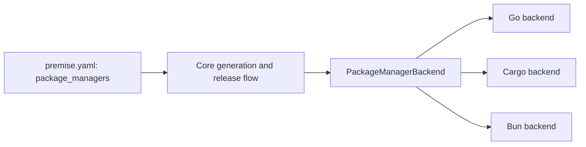
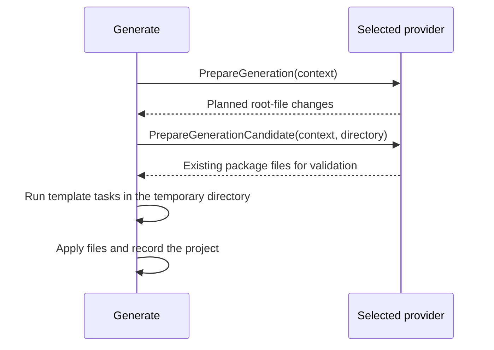
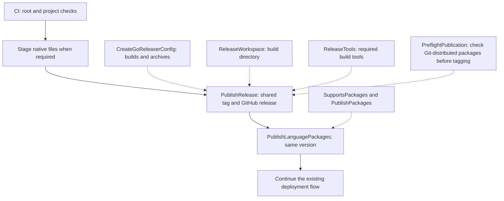
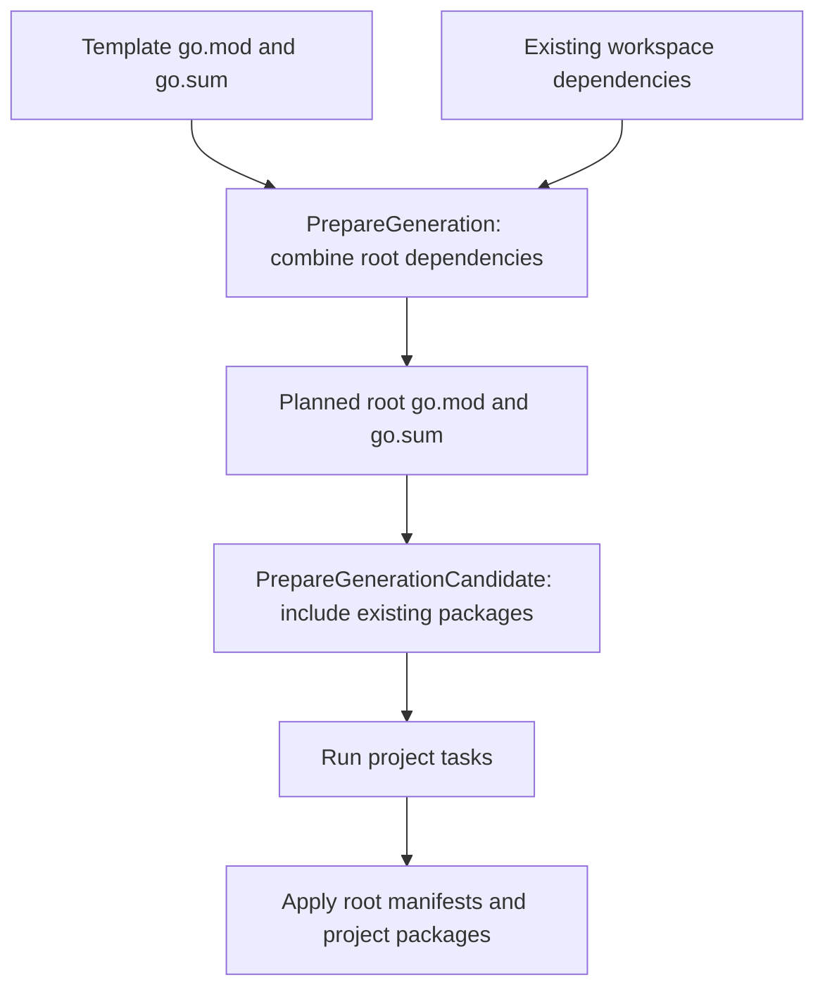
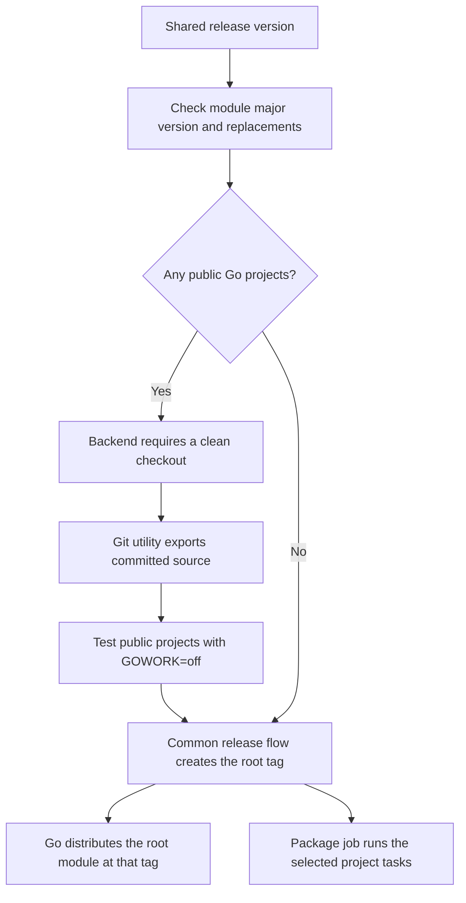

# Package Manager Module

## Purpose

The package-manager module defines how selected package ecosystems expose metadata, validate packages, contribute artifacts, and publish language packages. Core owns the contract and orchestration; `core/backends` contains built-in Go, Cargo, and Bun implementations.

## Design

### Usage

```go
if err := core.RegisterPackageManagerBackend(myBackend); err != nil {
    return err
}
```

```yaml
workspace:
  package_managers:
    - go
    - cargo
    - bun
```

The CLI registers built-ins in its composition root. Library clients register their own implementations explicitly; backends never self-register through `init`.

### API

| API | Use |
| --- | --- |
| `PackageManagerBackend.ID()` | Return the value accepted by `workspace.package_managers`. |
| `PackageManagerBackend.Ecosystem()` | Return the incompatibility key, such as `npm`, `cargo`, or `go`. |
| `GetPackageMetadata(root, template)` | Parse one native package specification into `PackageMetadata`. |
| `ValidatePackage(root, template)` | Perform static package validation. |
| `WillPublishOk(ctx, root, template, version, task)` | Preflight one package without publication. |
| `PreflightPublication(ctx, root, version, task)` | Check workspace publication before changes. |
| `CreateGoReleaserConfig(root, manifest)` | Contribute GoReleaser `builds` and `archives`. |
| `SupportsPackages()` | Report whether the manager handles language packages. |
| `PublishPackages(ctx, root, version, task, ...)` | Preflight and publish eligible packages. |
| `ReleaseWorkspace(ctx, root, ...)` | Prepare the workspace used for artifact builds. |
| `RegisterPackageManagerBackend(backend)` | Register an implementation before invoking release APIs. |
| `PackageManagerGeneration` | Prepare shared dependency files and the validation workspace. |
| `PackageManagerReleaseTools` | Select tools for executable builds. |
| `PackageManagerRepositoryPublication` | Require source checks before the shared Git tag makes packages available. |
| `PackageMetadata` | Carry manager-neutral package name, version, path, registry, visibility, and publication capability. |

## Implementation Details

### Interface and ownership

Premise selects providers from `workspace.package_managers`. Each provider implements `PackageManagerBackend`. Go, Cargo, and Bun use the same repository version and Git tag.



Core decides when checks, publication, and deployment run. Providers read native package files and run the commands for their package manager. A provider cannot choose a separate version for each project.

`GetPackageMetadata` reads package details. `ValidatePackage` checks those details without publication. `WillPublishOk` checks whether one package can run its publication task. `PreflightPublication` checks the selected packages as a group. The provider uses these checks inside its publication methods.

### Generation hooks

Some package managers need shared dependency files at the workspace root. Go uses these hooks to prepare one root `go.mod` and `go.sum` before creating the project:



`PackageManagerGeneration` defines both hooks. Providers that do not need them use the normal file merge. Planning does not change the user's root files. Core applies the prepared changes only after the temporary project passes its tasks.

### Release hooks and CI

CI runs root and project checks before publication. Project tasks stage native files when a platform needs them. The release job then publishes one repository tag and one combined GitHub release. The package job follows with the same version. Deployment starts only after publication succeeds.



`CreateGoReleaserConfig` describes downloadable files. `ReleaseWorkspace` selects their build directory. Providers can implement `PackageManagerReleaseTools` to name extra build tools. Core combines these results into the GitHub release.

Go packages become available when the tag exists. The Go backend implements `PackageManagerRepositoryPublication` so core calls its preflight check before creating that tag. Cargo and Bun upload packages to registries in the package job. Their registry credentials stay in that job. This changes where publication happens, not the version or tag.

See the [CI module](ci.md) for sequencing and the [release module](release.md) for tag and credential handling.

### Go generation

Go projects contain packages under one root module. The generation hook combines template dependencies with the root manifests. It also includes existing package sources when checking the temporary project.



The generated project has no nested `go.mod`. The workspace has no `go.work`. The root module path uses the repository path supplied by the user, without the application or library directory.

Go-specific merging stays in `core/backends/go.go`. Native Go file parsing stays in `core/extensions/gox.go`. Core generation calls the provider hooks and does not select Go by name.

### Go publication

`go.mod` has no setting for the publication tasks of an individual project. Go reads `package.public` from `premise.yaml`. Omission means `true`. A template can ask for this value with `populate: package.public`, and generation records the answer as a boolean. `false` skips that project's publication tasks. It does not exclude source from the root module.



The clean-checkout requirement belongs to the Go backend. The Git extension returns status data and exports the requested revision. Tests run against that export so ignored source cannot hide a broken release. The backend also rejects local filesystem replacements and a module path that does not match the release version. If no public projects exist, it skips the source tests and clean-checkout check.

Go applications can set `package.main` relative to their project directory and `package.binary` for the executable name. Without `main`, the backend looks for a main package in the project root. It creates an archive for each application. Libraries produce no executable. An existing root CLI keeps its archive names.

See [Using Premise with Go](../guides/go.md) for the user workflow.
