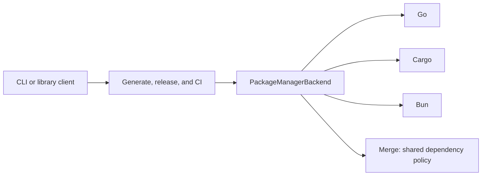
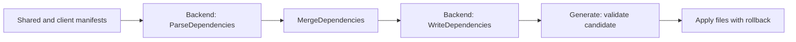
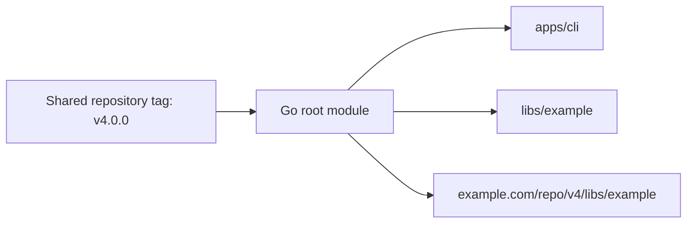
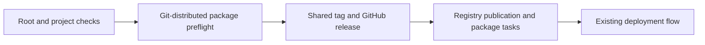

# Package Manager Module

## Purpose

Package-manager backends translate native manifests and commands into one contract. Go, Cargo, and Bun share the repository version and release flow.

## Design

### Usage

Select backends in `premise.yaml`:

```yaml
workspace:
  package_managers: [go, cargo, bun]
```

The CLI registers built-ins. Library clients call `core.RegisterPackageManagerBackend(backend)` before generation or release.

### Components



| Component      | Responsibility                                                             |
| -------------- | -------------------------------------------------------------------------- |
| Backend        | Parse and write native syntax; prepare membership; run native commands.    |
| Merge          | Combine dependency lists and resolve conflicts.                            |
| Generate       | Stage the candidate, run checks, capture outputs, and apply with rollback. |
| Release and CI | Choose the version and sequence checks, publication, and deployment.       |



### Core types and API

| Type | Contents |
| --- | --- |
| `PackageManagerBackend` | One interface for parsing, generation, metadata, and release hooks. |
| `Dependency` | Name, scope, version, native options, and indirect flag. |
| `PackageGenerationContext` | Staged project, original client files, declared shared files, project paths, and conflict resolver. |
| `PackageMetadata` | Name, version, path, registry, visibility, and publication capability. |

| Backend methods | Role |
| --- | --- |
| `ID`, `Ecosystem`, `SupportsPackages` | Identify the backend, ecosystem compatibility, and package support. |
| `GetPackageMetadata`, `ValidatePackage` | Read and validate native package details. |
| `ParseDependencies`, `WriteDependencies` | Translate native manifests to and from the common dependency model. |
| `ManagedWorkspaceFiles`, `PrepareGeneration` | Declare native root ownership and prepare contents. No selected native manifest means no native contribution. |
| `WillPublishOk`, `PreflightPublication`, `PublishesFromGitTag` | Check package and workspace publication requirements, including checks required before tagging. |
| `ReleaseTools`, `CreateGoReleaserConfig`, `ReleaseWorkspace` | Supply tools, artifacts, and the build directory. |
| `PublishPackages` | Publish eligible packages with the shared version. |

## Maintainer notes

### Native roots

| Backend | Roots | Project layout |
| --- | --- | --- |
| Go | `go.mod`, `go.sum` | One root module; packages under `apps/` and `libs/`; shared dependencies. |
| Cargo | `Cargo.toml`, `Cargo.lock` | Root workspace; project crates retain their own manifests. |
| Bun | `package.json`, `bun.lock`, `bun.lockb` | Root workspace; projects retain their own manifests. |

Backend preparation preserves client identity and settings. Registry identity and membership do not replace them. Native install tasks regenerate locks and Go checksums inside the candidate. Go removes the selected project's nested module files; it rejects existing independent modules rather than converting them.



Go's `package.public: false` skips project publication tasks. Source still belongs to the root module. `package.main` and `package.binary` select application entry points and executable names.

### Release boundary



Go source is available at the shared tag. Cargo and Bun upload to their registries afterward. Core owns this ordering; backends supply native checks and tasks.

| Where to look                     | Responsibility                           |
| --------------------------------- | ---------------------------------------- |
| `core/backends/{go,cargo,bun}.go` | Native behavior and serialization.       |
| `core/merge.go`                   | Shared merge policy.                     |
| `core/generate.go`                | Candidate staging, checks, and rollback. |
| `core/release.go`, `core/ci.go`   | Release and CI sequencing.               |

See [Merge](merge.md), [Generate](generate.md), [Release](release.md), and the [Go guide](../guides/go.md).
