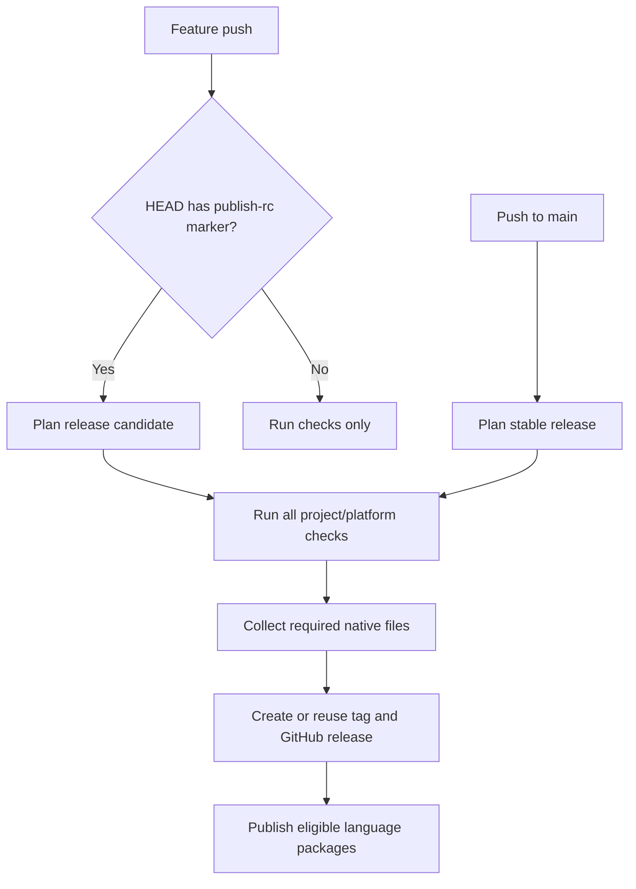
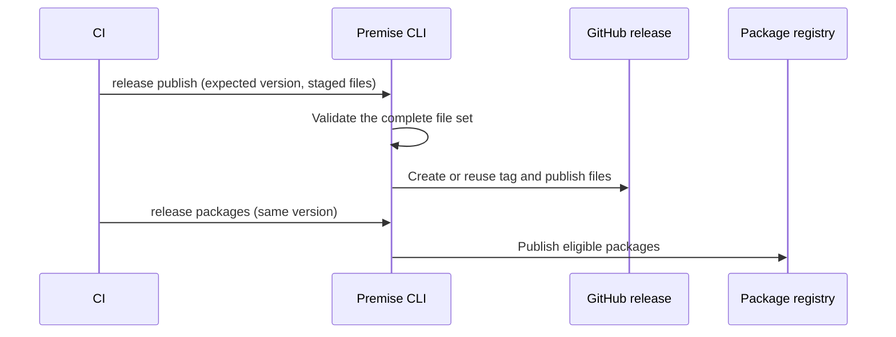

# Release Module

## Purpose

The release module plans repository releases, creates and reuses stable tags, combines selected package-manager artifacts, publishes GitHub releases, and invokes language-package publication in a defined order.

## Design

### Release flows

The workflow separates validation, downloadable files, and package publication:



Pull requests run checks without publication. A release candidate is a prerelease. It does not replace the latest stable release. The generated workflows keep publication credentials in their dedicated jobs.

### Usage

```bash
pm release             # prepare and publish the stable release
pm release --dry-run   # report the plan without changing the repository
pm release --build     # build release artifacts without publishing
```

```sh
pm release publish --channel rc --expected-version v1.2.3-rc.1 --files-dir /tmp/native-files
pm release packages --channel rc --expected-version v1.2.3-rc.1
```



For tandem PR validation, push a commit containing `[publish-rc]`. Wait for publication, then test the exact published RC in the dependent repository.

#Package publication and its credential preflight use repository or organization CI secrets. They do not select a GitHub deployment environment.
A library release on merge must not create a `production` deployment. Deployment environments belong to application infrastructure jobs.

## API

| API                                                  | Use                                                                    |
| ---------------------------------------------------- | ---------------------------------------------------------------------- |
| `PlanStableRelease(ctx, root)`                       | Decide whether to skip, create a tag, or reuse the stable tag at HEAD. |
| `PrepareStableRelease(ctx, root, stdout)`            | Plan and create/push a missing stable tag.                             |
| `PublishGitHubRelease(ctx, root, stdout, stderr)`    | Publish downloadable artifacts for a prepared tag.                     |
| `PublishLanguagePackages(ctx, root, stdout, stderr)` | Publish eligible registry packages for a prepared tag.                 |
| `PublishStableRelease(ctx, root, stdout, stderr)`    | Prepare, publish GitHub artifacts, then publish packages.              |
| `BuildReleaseArtifacts(ctx, root, stdout, stderr)`   | Build the complete artifact matrix without tags or publication.        |
| `GoReleaserConfig(root)`                             | Return the merged GoReleaser configuration as bytes.                   |
| `ReleasePlan`                                        | Return the selected version plus skip/reuse decisions.                 |

## Implementation Details

Release loads `premise.yaml`, resolves explicitly selected registered backends, and rejects missing or conflicting managers before release work. It asks each selected backend for artifact fragments, merges `builds` and `archives`, and rejects unknown sections and duplicate artifact IDs.

`PlanStableRelease` reads tags and compares the current version with the next version. It reuses a stable tag at `HEAD`. When no stable tag exists, it uses `v0.0.0` as the version baseline and plans the first feature release as `v0.1.0`.

GoReleaser configuration is written to a temporary file. Release calls the Mise subprocess boundary directly to resolve a pinned GoReleaser tool environment; it does not call the public Task module entry points. Package-registry credentials are removed, while GitHub credentials are added explicitly. Temporary configuration is removed after execution.

`BuildReleaseArtifacts` uses GoReleaser snapshot mode. It builds the configured artifacts but neither tags nor publishes them. If no backend contributes downloadable artifacts, it skips the build.

Backends that contribute artifacts must agree on one release workspace. Their serial requirements are combined; Cargo requests serial GoReleaser execution after preparing its toolchain.

Language-package credentials are excluded from general Mise and GoReleaser environments. Backends receive only the credentials needed for their publication subprocesses. Missing or invalid credentials fail before publication; correct them and rerun, reusing the existing tag. Context cancellation propagates to Git operations, Mise, registry checks, and GoReleaser.

### CI staging and publication

Project `release:build` tasks copy native output into the directory selected by the CI flow. They do not tag or publish. The hosted release job downloads every required native file and validates the complete set before creating or reusing a tag at the triggering commit. `pm release publish --channel rc --expected-version VERSION --files-dir DIRECTORY` publishes one combined GitHub release. `pm release packages` runs afterward with registry credentials isolated to that job.

A `[publish-rc]` feature-branch push requests a GitHub prerelease. RCs do not replace the latest stable release. A dry release plan validates inputs without tags or publication. Native files are transferred as artifacts rather than caches. For Tauri, the project-owned Cargo/Mise task stages NSIS output for Windows RCs and can stage MSI output for stable releases.
