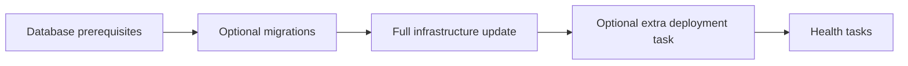

# User Guide

Premise creates projects from templates and runs their tasks through Mise. A workspace groups applications, libraries, and infrastructure in one repository.

## Install

Install Premise and its `pm` alias:

```sh
curl -fsSL https://raw.githubusercontent.com/cloudvoyant/premise/main/install.sh | bash
```

Install [Mise](https://mise.jdx.dev/) for project tools. Update Premise with `pm update` or select a release with `pm update VERSION`.

## Create a workspace

```sh
mkdir my-product
cd my-product
pm init
pm g :premise-tanstack-start-app
pm install
```

Answer the template questions to name your app. Premise records the project in `premise.yaml` and places its files under `apps/`. Library templates use `libs/`.

Choose a registry or a specific template:

```sh
pm g cloudvoyant/premise-bun
pm g cloudvoyant/premise-bun:premise-hono-api
pm g ../my-registry:app
```

`pm g` opens the official template picker. A local registry path lets you test unmerged template changes. Remote selectors use the repository’s default branch.

## Run project tasks

For an app named `web`, run:

```sh
pm run web:dev
pm run web:test
pm run build
```

The last command runs the root `build` task. Tasks live in each project's `mise.toml`. Arguments after the task name pass through to Mise.

Run a task across the workspace:

```sh
mise run --jobs 1 '//...:build'
mise run --jobs 1 '//...:test'
```

## Check a change

```sh
pm ci flow on-commit --release none
pm ci plan --flow on-commit --json
pm projects ls --flow on-commit --json
```

The flow runs project checks. The plan reports the required runners without running tasks. CI uses the same commands and can create separate project/platform jobs. See [CI](modules/ci.md).

## Add infrastructure

A Pulumi program declares your resources. A stack holds one environment’s state. Use one program with separate `dev`, `stage`, `prod`, and feature-branch preview stacks.

For a GCS bucket, generate the template and bind an app’s built files:

```sh
pm g cloudvoyant/premise-pulumi:gcs-bucket --answer name=environment
pm infra bind web environment --artifact dist
```

During tandem PR development, select the local `premise-pulumi` checkout instead. Remote templates use the default branch.

Supply an existing state bucket and the GCP resource project:

```sh
export PULUMI_BACKEND_URL=gs://YOUR_STATE_BUCKET
```

```yaml
# Add these entries under workspace in premise.yaml.
infra:
  providers: [gcp]
  environments:
    dev:
      config:
        gcp:project: YOUR_GCP_PROJECT
    preview:
      config:
        gcp:project: YOUR_GCP_PROJECT
```

Install the template’s tools, then authenticate locally through OAuth:

```sh
pm install
pm infra auth
pm infra init --env dev
pm infra test
pm infra plan --env dev
pm infra apply --env dev --yes
pm infra output --env dev
```

`plan` previews changes. `apply` changes resources. The project argument is optional because these commands select the environment stack. A declared component target can filter an update within that stack.

## Create a branch preview

On a feature branch, run:

```sh
git switch -c feature/login
pm infra init --env preview
pm infra plan --env preview
pm infra apply --env preview --yes
```

Premise uses the current branch to select a stable preview stack. Further pushes update the same stack. The same program handles each branch through parameters.

Destroy this preview when you finish:

```sh
pm infra destroy --env preview
```

After you enable `PREMISE_DEPLOY_ENABLED` and configure provider credentials, `on-commit.yml` deploys feature-branch previews. `on-merge.yml` cleans them up after a same-repository PR merge or branch deletion. `on-deploy.yml` runs only when started manually. Persistent environments require interactive confirmation for destruction.

## Deploy with migrations

Use `pm deploy` when a deployment needs database provisioning, migrations, or recovery tasks. The order is:



Declare task names, prerequisite resource targets, and recovery tasks under `workspace.deployment`. See the [complete configuration](modules/infrastructure.md#deploy-in-order).

```sh
pm deploy plan --env stage
pm deploy run --env stage --release COMMIT_SHA --artifact web=IMMUTABLE_ARTIFACT_ID
```

Pulumi deploys applications that it owns. Add a project `deploy` hook only for work outside Pulumi. On failure, client recovery tasks use the previous successful release. The client must provide backward-compatible migrations. Premise does not run database down migrations.

Persist recovery records across CI runs and serialize deployments per environment. The [infrastructure guide](modules/infrastructure.md) explains recovery inputs and first-deployment cleanup.

## Pull application secrets

Declare application keys and local fnox profiles in the project’s `secrets` configuration. Keep `.env.local` Git-ignored:

```sh
pm secrets pull --env dev --project web
pm secrets exec --env dev --project web -- mise run migrate
```

`pull` writes a private local env file. `exec` supplies values to one child process. Fnox can read local secret files or a secret service through Mise.

Copy selected local values into CI secrets:

```sh
pm secrets sync --env stage --project web --ci github --repository owner/repo
```

CI reads the declared variables directly. Deployment OAuth credentials and administration tokens remain separate from application values. See [Secret management](secret-management.md) and the individual [provider guides](providers/README.md).

## Publish a release

Check the next version or build files without publication:

```sh
pm version current
pm version next
pm release --dry-run
pm release --build
```

Publish from a clean checkout after checks pass:

```sh
pm release
```

The generated main-branch workflow publishes stable releases. It creates or reuses the release tag, publishes downloadable files, then publishes eligible language packages.

For an RC that another repository must test, include the exact marker in a feature-branch commit:

```sh
git commit -m 'feat: add deployment support [publish-rc]'
git push
```

Wait for publication before selecting that RC in the dependent repository. Keep the action and CLI on the same version. Pull requests run checks without publishing. See [Release](modules/release.md) for staged publication and credential setup.

## Create templates

Create a registry and test its templates:

```sh
pm init --kind template-registry
pm template init app
pm template ls
pm template test
```

Register template questions and literal substitutions in `premise.yaml`. Templates remain valid projects before generation. Root files listed in `template_registry.workspace_files` are shared with the client. Premise asks about conflicting root files before it writes the generated project.

Infra templates create executable programs under `infra/`. Component templates create reusable Go components under `infra/components/`. Clients can also author components there directly. See [Generation](generation.md) and [Infrastructure](modules/infrastructure.md).

## Limits

Generation creates new projects. It does not update existing ones. Remote selectors use the default branch and need network access. Private-template authentication and offline operation remain separate work.

Pulumi state uses an empty passphrase for now. Backend access controls and storage encryption protect it. Existing encrypted stacks still require their original key.
